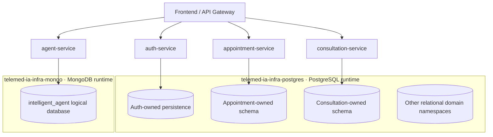
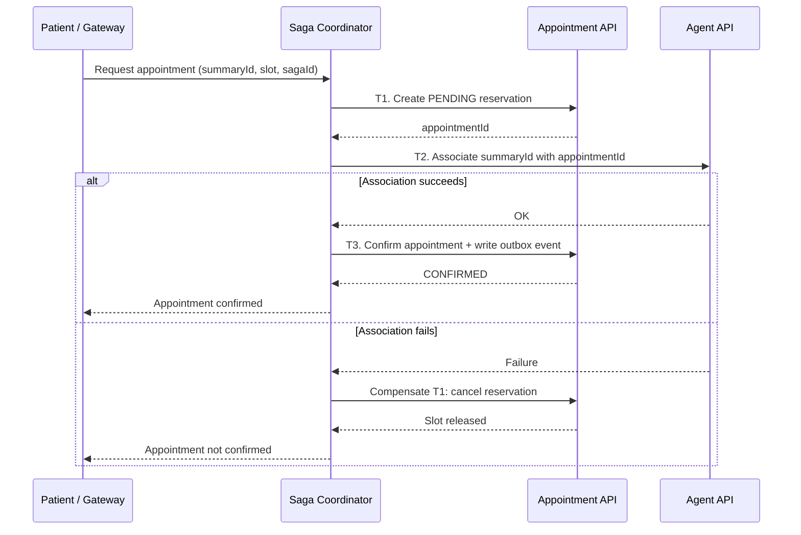
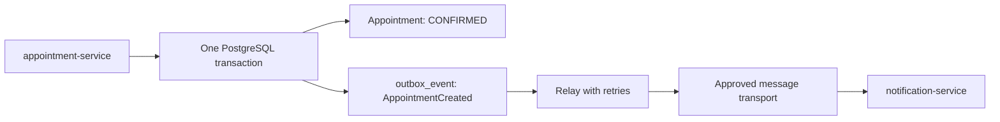

# TeleMed IA — Corte 2 | Distributed Persistence and MVP 2 Release

> **Unit 3 · Distributed Persistence · Corte 2**  
> **Project:** TeleMed IA — Telemedicine Platform with an Intelligent Agent  
> **Weekly objective:** Give each service ownership of its database, implement one saga with compensation, use a transactional outbox for one critical event, make event consumers idempotent, and demonstrate the integrated **MVP 2 release in Session 2**.

## 1. Weekly scope and implementation status

MVP 2 moves beyond individual microservices running successfully: the goal is to demonstrate an **integrated distributed system**. Services must maintain ownership of their data, coordinate cross-service workflows through local transactions, recover from partial failures, and publish and process events reliably.

**Evidence rule:** This README deliberately distinguishes an *accepted architectural decision*, an *existing database structure or contract*, and a *feature proven to work end to end*. A diagram, an event definition, or an outbox collection alone does **not** demonstrate a working distributed flow.

| Weekly requirement | Existing TeleMed IA evidence | Status / what still needs verification |
|---|---|---|
| Database per Service | ADR-004; Data Ownership Matrix; dedicated `-db` repositories; infrastructure-managed PostgreSQL and MongoDB | **Architecture accepted; implementation varies by domain.** Verify isolation and database permissions in an integrated environment. |
| One saga with compensation | Service boundaries and communication contracts; intended workflow repository | **Not yet demonstrated.** Implement a real cross-service workflow with durable state and an observable compensation. |
| Transactional outbox for one critical event | Agent's `outbox_events` collection; `AppointmentCreated` contract | **Partially prepared.** Implement the Appointment outbox transaction, delivery relay, and broker integration for the selected event. |
| Idempotent consumers | Agent's `idempotency_records`; event contracts containing `eventId` | **Not sufficient to prove consumer idempotency.** Implement persistent event deduplication and a duplicate-delivery test. |
| MVP 2 release (Session 2) | Repository branching policy, environment promotion practices, CI and deployment repositories | **End-to-end release evidence is pending.** Validate integration and failure scenarios, complete the demo, and verify the actual release tag. |

> **Important distinction:** HTTP request idempotency (`Idempotency-Key`) and event consumer idempotency (`eventId`) are different mechanisms. Both should be tested independently.

## 2. Database per Service: independent ownership of persistent data

### 2.1. Accepted architecture

TeleMed IA uses **Database per Service as a logical ownership boundary for each bounded context**. According to [ADR-004](https://github.com/code-corhuila/telemed-ia-docs/blob/main/05-architecture/decisions/records/ADR-004-database-per-service.md) and the project's repository standard, services do **not** require separate physical PostgreSQL containers. A single database runtime can host isolated, service-owned databases or schemas; business data, migrations, write permissions, and business rules still belong exclusively to each service.

- `telemed-ia-infra-postgres` manages the shared PostgreSQL runtime for relational domains.
- `telemed-ia-infra-mongo` manages the MongoDB runtime used by the Intelligent Agent.
- Each domain-specific `telemed-ia-<domain>-db` repository owns its schema or logical database, migrations, constraints, indexes, and domain access permissions.
- Inter-service access uses **documented APIs and domain events** instead of directly modifying another domain's persistence.
- Cross-domain identifiers are stored as external references; cross-domain database foreign keys are prohibited.
- An exceptional read-only cross-domain database access requires explicit approval and technical-debt documentation under ADR-004; it is not the default integration mechanism.

### 2.2. Ownership matrix

| Microservice | Persistence | Owned business data |
|---|---|---|
| `auth-service` | PostgreSQL | Accounts, roles, password hashes, authentication and password-recovery state. |
| `patient-service` | PostgreSQL | Patient profiles and authorized patient information. |
| `professional-service` | PostgreSQL | Healthcare professional profiles, specialties, and domain relationships. |
| `agent-service` | MongoDB (`intelligent_agent`) | Conversations, messages, `PreConsultationSummary`, idempotency records, and Agent outbox events. |
| `appointment-service` | PostgreSQL (`appointment_scheduling`) | Appointments, appointment lifecycle, and professional availability. |
| `consultation-service` | PostgreSQL (`medical_consultation`) | Consultations, diagnoses, recommendations, medication instructions, and post-consultation summaries. |
| `notification-service` | PostgreSQL (target) | Notification delivery records and statuses; definitive schema still pending in the reviewed documentation. |
| `document-service` | PostgreSQL (metadata) | Document metadata, PDF references, and generation status; clinical conclusions remain owned by Consultation. |



**Where to find evidence:** [Data Ownership Matrix](https://github.com/code-corhuila/telemed-ia-docs/blob/main/09-microservices/data-ownership-matrix.md), [ADR-004](https://github.com/code-corhuila/telemed-ia-docs/blob/main/05-architecture/decisions/records/ADR-004-database-per-service.md), [PostgreSQL Infrastructure](https://github.com/code-corhuila/telemed-ia-infra-postgres), [MongoDB Infrastructure](https://github.com/code-corhuila/telemed-ia-infra-mongo), and [Intelligent Agent DB](https://github.com/code-corhuila/telemed-ia-intelligent-agent-db).

**Verification:** Run domain-specific migrations, inspect the resulting schemas and collections, and demonstrate that one domain's application identity cannot modify another domain's objects. MongoDB role/permission checks and Liquibase migration tests demonstrate database-layer progress; they do **not** alone prove that the Agent API is integrated.

## 3. Saga: a distributed workflow with compensation

### 3.1. Proposed TeleMed IA use case

**Scenario:** Schedule an appointment and associate an existing Intelligent Agent pre-consultation summary with that appointment.

This scenario spans two independent data owners:

1. `appointment-service` reserves an appointment slot.
2. `agent-service` associates its `PreConsultationSummary` with the appointment through **its API**, without transferring ownership of clinical or conversational content.
3. `appointment-service` confirms the appointment and persists the `AppointmentCreated` outbox event.

> **Implementation proposal, not an existing verified workflow:** This example requires an idempotent summary association/disassociation contract in Agent and explicit pending/confirmed/cancelled reservation transitions in Appointment. These operations must be designed, approved, implemented, and tested before the saga can be marked complete.

### 3.2. Local transactions and compensations

| Step | Service | Normal local action | Compensation if a later step fails |
|---|---|---|---|
| T1 | Appointment | Reserve an available slot and create a `PENDING` appointment. | Cancel the reservation and release the slot. |
| T2 | Agent | Associate `summaryId` with `appointmentId` without copying clinical content. | Remove the association **without deleting the pre-consultation summary**. |
| T3 | Appointment | Transition the appointment to `CONFIRMED` and insert `AppointmentCreated` into its outbox in the same transaction. | If T3 fails, reverse T2 and T1 as necessary. |



**Consistency requirements:** Every local step commits only within its owner's database. The coordinator must persist `sagaId`, execution state, retry information, and compensation outcomes. No global ACID transaction is assumed. A failed T3 may require both compensations; failures during compensation must remain recoverable through controlled retries or manual reconciliation.

**Acceptance test:** Stop Agent during T2. The appointment must not remain confirmed, and the reserved time slot must become available again. Also test a failure after T2 to verify that association and reservation are both reversed. The pre-consultation record must remain intact.

## 4. Transactional Outbox: reliable `AppointmentCreated` publication

**Selected critical event:** `AppointmentCreated`.

- **Producer:** `appointment-service`.
- **Intended consumer:** `notification-service`.
- **Purpose:** Trigger appointment-confirmation processing without making appointment creation dependent on notification service availability.
- **Source of truth:** [TeleMed IA Event Catalog](https://github.com/code-corhuila/telemed-ia-docs/blob/main/09-microservices/event-catalog.md).

### 4.1. The dual-write problem

Without an outbox, Appointment might commit the appointment to PostgreSQL and crash before publishing the event. The appointment would exist but its notification would never be triggered. The **Transactional Outbox Pattern** prevents this specific loss by storing the appointment update and the pending event **in the same Appointment-local database transaction**.



### 4.2. Example event envelope

The following follows the event catalog's field names; placeholder values are illustrative.

```json
{
  "eventId": "<EVENT_UUID>",
  "eventType": "AppointmentCreated",
  "occurredAt": "<ISO_8601_TIMESTAMP>",
  "correlationId": "<CORRELATION_UUID>",
  "version": 1,
  "payload": {
    "appointmentId": "<APPOINTMENT_UUID>",
    "patientId": "<PATIENT_UUID>",
    "professionalId": "<PROFESSIONAL_UUID>",
    "startDateTime": "<ISO_8601_TIMESTAMP>",
    "preConsultationSummaryId": "<SUMMARY_UUID>"
  }
}
```

**Required behavior:**

1. In a single transaction, change the appointment to `CONFIRMED` and insert a pending outbox record.
2. A relay fetches pending events and publishes them using the transport approved by the architecture decision.
3. Mark an event published **only after delivery is acknowledged**; otherwise, preserve it for retry.
4. Support **at-least-once** delivery. Duplicates are possible, so consumers must be idempotent; do not claim a general exactly-once guarantee.
5. Keep event payloads minimal and free of passwords, tokens, full clinical notes, or conversation content.

**Current documented limitation:** The Appointment API README describes a `NoOpEventPublisher`; a defined `AppointmentCreated` contract is therefore **not** proof of real event delivery. The Agent database separately defines an `outbox_events` collection for `PreConsultationSummaryGenerated`, but it cannot substitute for the Appointment outbox selected here. RabbitMQ remains **Proposed** in [ADR-011](https://github.com/code-corhuila/telemed-ia-docs/blob/main/05-architecture/decisions/records/ADR-011-message-broker.md), rather than an accepted, proven broker integration.

### 4.3. Evidence needed

- A versioned outbox migration in `telemed-ia-appointment-scheduling-db`.
- Code showing a single `confirm appointment + insert outbox event` transaction.
- The configured relay, its retry behavior, and publication acknowledgements.
- A crash test between commit and publish: the event remains pending, and the relay publishes it after recovery.
- Logs showing `eventId`, `correlationId`, attempts, and outcomes, **without protected medical information or secrets**.

## 5. Idempotent event consumers

An event consumer is **idempotent** when delivery of the same `eventId` multiple times produces the intended business outcome only once.

**Example:** `notification-service` receives `AppointmentCreated` to prepare a confirmation notification. Redelivery must not create another notification job for the same event.

**Proposed consumer algorithm:**

1. Read `eventId` from the event envelope.
2. Enforce a unique processed-event key such as `(consumerName, eventId)` in the consumer's own persistent store.
3. Save the processed-event record **and** create the local notification job in one local transaction.
4. When the key already exists, acknowledge the duplicate without creating an additional business record.
5. Deliver external email through a durable delivery workflow. If the external provider lacks idempotent sending, do not promise exactly one email under all crash scenarios.

```text
First delivery of eventId = E1
  -> Store processed marker for E1
  -> Create 1 notification job

Second delivery of eventId = E1
  -> Existing processed marker detected
  -> Create 0 additional jobs
```

**Mandatory test:** Deliver event `E1` twice, prove that only one local business effect is recorded, and capture `DUPLICATE` (or equivalent) in the logs. Repeat after a consumer crash and restart.

> Agent's `idempotency_records` collection protects repeated Agent operations. By itself, it does **not** prove that Notification deduplicates incoming `AppointmentCreated` events.

## 6. Session 2 — MVP 2 integrated release

MVP 2 is complete only when the services work together under normal conditions **and** recover correctly from a deliberately injected failure.

### 6.1. Promotion and versioning

The project follows a PR-only model for its permanent branches:

```text
feat/* or fix/*  --> PR --> develop
qa/*            --> PR --> qa
release/2.0.0   --> PR --> main
                                  |
                                  +--> version tag (verify the actual tag per repository)
```

Promotions use **re-application with `git cherry-pick -x`**, never direct merges from `develop` to `qa` or from `qa` to `main`. Build the release branch from `main` using only changes previously verified in QA. Retain story-level traceability through commits, PRs, pipeline runs, approvals, and the release changelog.

**Version note:** The academic release example uses `v2.0.0`, but some TeleMed IA repositories may actually use `2.0.0`. Report the **real tag** found in each repository; do not assert that an unverified `v2.0.0` tag exists.

### 6.2. Definition of Done (DoD) checklist

- [ ] All committed user stories meet their acceptance criteria.
- [ ] Unit tests pass for each participating service.
- [ ] Integration tests exercise real, service-owned persistence.
- [ ] API/event contract tests verify producer–consumer compatibility.
- [ ] Docker Compose starts the required system with reliable health checks.
- [ ] The API Gateway provides a working end-to-end flow.
- [ ] The saga has been demonstrated with an injected failure and a successful compensation.
- [ ] A transactional outbox and relay survive a crash before publication.
- [ ] An idempotent consumer handles two deliveries of the same `eventId` with one business effect.
- [ ] Configuration and secrets are environment-specific (`dev`, `qa`, release); secrets are absent from Git and container images.
- [ ] Database migrations are versioned and reproducible per bounded context.
- [ ] The real release tag, CHANGELOG, ADRs, and release PR can be verified.
- [ ] Each contributor has `hu-status` evidence, commits, PRs, and pipeline results.
- [ ] The Corte 2 retrospective and Corte 3 backlog are recorded.

### 6.3. Reference commands to collect evidence

Run each command **from the correct repository**, with the relevant services and environment variables configured. These commands validate components but do **not**, by themselves, certify the complete MVP 2 release.

**Identity & Access API (Java / Maven)**

```bash
mvn -B clean verify
```

**Appointment API (Python / FastAPI)**

```bash
ruff check src/ tests/
pytest -q
```

**PostgreSQL infrastructure (from `telemed-ia-infra-postgres`)**

```bash
docker compose --env-file env/dev.env config --services
docker compose --env-file env/dev.env --profile tooling run --rm appointment-scheduling-db-migrate
docker compose --env-file env/dev.env --profile tooling run --rm identity-and-access-db-migrate
```

**MongoDB / Agent (from the Compose setup that includes the Agent migration runner)**

```bash
docker compose --env-file env/dev.env --profile tooling run --rm intelligent-agent-db-migrate
```

**Git history and tags (run separately in each released repository)**

```bash
git log --oneline --decorate -n 12
git tag --list
git status --short
```

> Docker Compose `include:` paths depend on the actual sibling repository layout. Resolve missing paths before treating a local startup as release evidence. Do not expose credentials in screenshots or CI logs.

### 6.4. Demonstration script

| Step | Demonstration action | Evidence to show |
|---|---|---|
| 1 | Start the required infrastructure and APIs. | Healthy services, applied migrations, QA configuration. |
| 2 | Run a request through the API Gateway. | Valid responses, proper service contracts, no cross-domain SQL access. |
| 3 | Book an appointment with a pre-consultation summary. | Correct state in Appointment and an authorized reference in Agent. |
| 4 | Stop Agent during the association step. | Saga compensation: cancelled reservation and released time slot. |
| 5 | Retry with the same operation identifier. | No duplicate reservation or association. |
| 6 | Confirm an appointment and stop the event relay. | Outbox event persists as pending and is later published on recovery. |
| 7 | Redeliver `AppointmentCreated` twice. | Consumer performs one local business operation. |
| 8 | Present QA, release PR, CI, tag, and CHANGELOG. | Reproducible version and traceable user stories. |

**A happy-path-only demonstration is not enough.** Intentionally inject a failure and verify the resulting state in each **owning service's** database.

## 7. Evidence directory and reporting format

Store screenshots, test reports, CI links, and logs in an organized documentation folder; remove secrets and sensitive patient data.

```text
evidence/corte-2/mvp-2/
├── 01-data-ownership/       # Schemas, collections, permissions, migrations
├── 02-saga-compensation/    # Tests, saga states, before/after evidence
├── 03-outbox/               # Transaction, pending event, relay recovery
├── 04-idempotency/          # Duplicate event, one business effect
├── 05-integration/          # Gateway, contracts, health checks, E2E
├── 06-release/              # QA, PRs, CI, tags, CHANGELOG
└── 07-retrospective/        # Lessons learned and Corte 3 backlog
```

For each item, document the **date, repository, branch/commit or tag, test command or scenario, expected result, observed result, CI/PR link, and responsible contributor**. Never include passwords, access tokens, personal patient emails, or medical records.

## 8. Open risks and Corte 3 follow-up

| Current limitation / risk | Required verifiable action |
|---|---|
| No confirmed running saga in the workflow repository | Implement a saga coordinator, persistent execution state, compensations, and failure tests. |
| Appointment currently uses `NoOpEventPublisher` | Add a local transactional outbox, a real relay, and formally approved transport. |
| Appointment HTTP idempotency is currently stored in memory | Move idempotency state to durable shared persistence before scaling replicas. |
| Event contracts do not prove runtime delivery | Validate publication, consumption, acknowledgement, retries, and deduplication. |
| Notification and Agent API integration is not yet demonstrated | Complete required service contracts and verify the integrated workflow. |
| Some legacy database identifiers differ from target UUID contracts | Align through domain-owned migrations, without cross-domain foreign keys. |
| Incomplete Compose configuration or incorrect relative paths | Consolidate the composition and verify health-gated startup and restart. |

**Conclusion:** TeleMed IA has documented data-ownership boundaries and concrete persistence/infrastructure progress. The weekly deliverables and MVP 2 release should only be marked **completed** after the saga, compensation, outbox, idempotent consumers, and end-to-end integration have run successfully and produced reproducible evidence.

## 9. Project references

- [TeleMed IA — central documentation](https://github.com/code-corhuila/telemed-ia-docs)
- [ADR-004 — Database per Service](https://github.com/code-corhuila/telemed-ia-docs/blob/main/05-architecture/decisions/records/ADR-004-database-per-service.md)
- [Data Ownership Matrix](https://github.com/code-corhuila/telemed-ia-docs/blob/main/09-microservices/data-ownership-matrix.md)
- [Event Catalog](https://github.com/code-corhuila/telemed-ia-docs/blob/main/09-microservices/event-catalog.md)
- [ADR-011 — Message Broker (Proposed)](https://github.com/code-corhuila/telemed-ia-docs/blob/main/05-architecture/decisions/records/ADR-011-message-broker.md)
- [Branching Policy](https://github.com/code-corhuila/telemed-ia-docs/blob/main/00-governance/branching-policy.md)
- [PostgreSQL Infrastructure](https://github.com/code-corhuila/telemed-ia-infra-postgres)
- [MongoDB Infrastructure](https://github.com/code-corhuila/telemed-ia-infra-mongo)
- [Appointment Scheduling API](https://github.com/code-corhuila/telemed-ia-appointment-scheduling-api)
- [Appointment Scheduling DB](https://github.com/code-corhuila/telemed-ia-appointment-scheduling-db)
- [Intelligent Agent DB](https://github.com/code-corhuila/telemed-ia-intelligent-agent-db)
- [Workflow](https://github.com/code-corhuila/telemed-ia-workflow)

---

*Documentation cross-checked against the TeleMed IA repositories on October 11, 2026. All proposed workflows, unimplemented contracts, and demonstration steps require execution and supporting evidence before claiming that MVP 2 has been released.*
