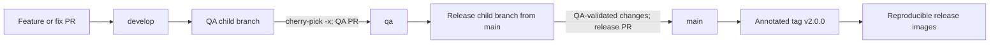
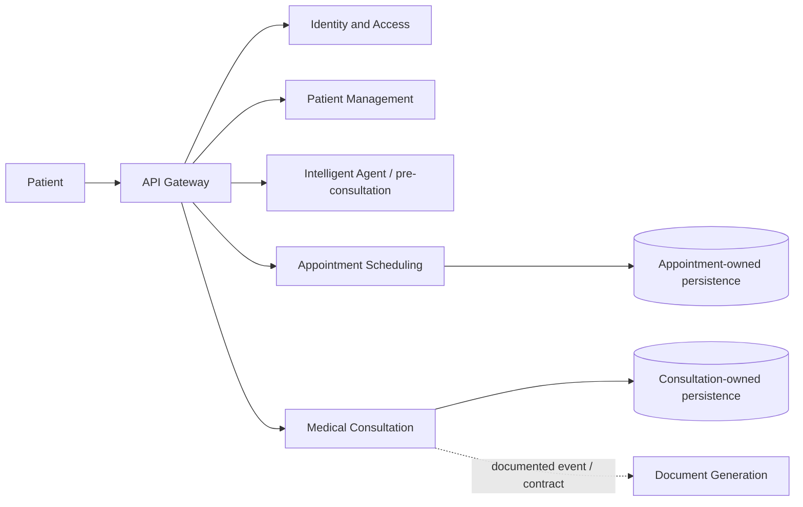
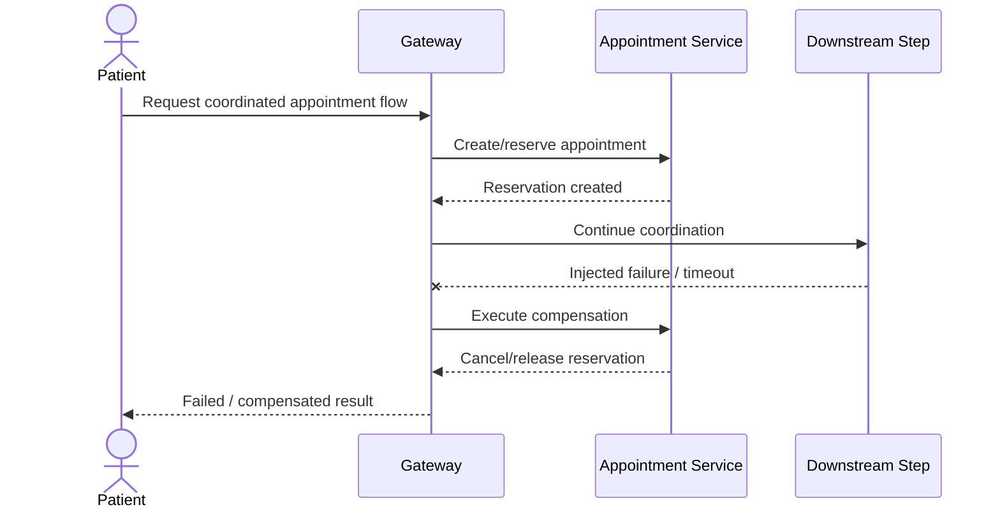
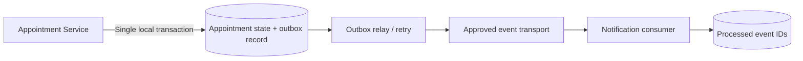

# TeleMed IA — Corte 2 | MVP 2 Release

> **Unit 3 · Release · Corte 2**  
> **Release target:** `v2.0.0`  
> **Project:** TeleMed IA — Distributed Telemedicine Platform with Intelligent Agent  
> **Document purpose:** Release plan, Definition of Done, demonstration script, and evidence register.

## 1. Objective

Deliver **MVP 2 as an integrated distributed system**, not merely as a collection of individually running services. The Corte 2 release must demonstrate service-to-service communication through documented contracts, domain-owned persistence, safe handling of failures, and a reproducible release candidate.

The release objectives are to:

1. Promote the QA-validated increment to `main` and create the `v2.0.0` tag.
2. Verify the release checklist, including **at least one failure and compensation path**.
3. Demonstrate the integrated TeleMed IA workflow with an intentionally injected failure.
4. Close Corte 2 with a retrospective and transfer actionable improvements to Corte 3.
5. Complete each team member's **individual `hu-status` evidence**.

> **Evidence rule:** This README describes the release requirements and the evidence that must be attached. An unchecked box is **not** proof of completion. Do not declare MVP 2 released until the corresponding PRs, test runs, runtime logs, and demonstration records are available.

## 2. What MVP 2 changes

| MVP 1 | MVP 2 release expectation |
| --- | --- |
| Individual service starts successfully | Multiple services operate together through real interfaces |
| Local endpoints and isolated functionality | An end-to-end patient or consultation journey is demonstrable |
| Service-specific persistence | Explicit domain ownership and cross-service references |
| Happy-path verification | Successful flow **and** failure/compensation verification |
| Development-only proof | QA validation, reproducible version tag, and release evidence |

TeleMed IA uses the **Database-per-Service ownership principle**: every bounded context owns its business data and migrations, even when several PostgreSQL domains share the same *physical* PostgreSQL runtime. MongoDB serves the Intelligent Agent domain. Sharing infrastructure does not permit cross-domain writes or foreign keys.

Relevant components include the `auth-service`, `patient-service`, `professional-service`, `agent-service`, `appointment-service`, `consultation-service`, `notification-service`, and `document-service`, alongside the API Gateway and infrastructure repositories. Only services actually integrated and verified belong in the final MVP 2 scope.

## 3. Release workflow: `develop` → `qa` → `main`

TeleMed IA follows **promotion by re-application**. Permanent branches are **not merged into each other**. Each change enters the target branch through a child branch and a Pull Request (PR).



### Required procedure

1. **Development:** Complete the committed user stories, reviews, and CI checks in `develop`.
2. **QA:** Create a `qa/...` child branch from `qa`; re-apply the approved commit(s) with `git cherry-pick -x`; submit a PR to `qa`; run the applicable integration, contract, and failure-path tests.
3. **Release:** Create `release/2.0.0` from `main`; add **only changes validated in QA**, retaining `cherry picked from` provenance; submit the release PR to `main`.
4. **Approval:** Obtain the repository's required checks and **one approval from `ariel5253`**, with CODEOWNERS and conversation-resolution requirements satisfied.
5. **Tag:** After the approved release PR is merged, tag the verified `main` commit **`v2.0.0`** and publish the tag. Tags are repository-specific; every included deployable repository must have a clearly documented immutable release reference.
6. **Build/deploy:** Build images from the release commits/tags and run them with the target environment's configuration and externally supplied secrets.

Illustrative tagging commands (run only after confirming that the repository's `main` contains the approved release):

```bash
git fetch origin --tags
git switch main
git pull --ff-only origin main
git status --short
git tag -a v2.0.0 -m "TeleMed IA MVP 2 — Corte 2 release"
git push origin v2.0.0
```

If `v2.0.0` already exists, **do not move or overwrite it**. Verify its commit and coordinate any correction through the project's release procedure.

### Release traceability

| Evidence | Link / value | Status |
| --- | --- | --- |
| QA-approved user stories / PRs | _Add URLs_ | ☐ Pending |
| Release PR(s) to `main` | _Add URLs_ | ☐ Pending |
| Required reviewer approval and green checks | _Add URLs_ | ☐ Pending |
| Exact `main` commit(s) | _Add SHAs_ | ☐ Pending |
| `v2.0.0` tag / release references | _Add URLs_ | ☐ Pending |
| Image digest(s), build run(s), and environment | _Add URLs / digests_ | ☐ Pending |
| CHANGELOG and relevant ADR updates | _Add URLs_ | ☐ Pending |

## 4. MVP 2 Definition of Done (release checklist)

### Functional integration

- [ ] Acceptance criteria are met for every user story committed to MVP 2.
- [ ] All included services start with the agreed deployment composition and pass health checks.
- [ ] An end-to-end flow is executed through the **API Gateway**, where applicable, rather than by manually modifying databases.
- [ ] Service contracts (OpenAPI and/or event contracts) match actual consumer and producer behavior.
- [ ] Every service accesses **its own** persistence namespace; cross-domain information is obtained through approved APIs or events.

### Reliability and consistency

- [ ] Unit, integration, and contract tests are green, and coverage claims are supported by measured reports.
- [ ] A deliberately injected downstream failure is handled without leaving an invalid business state.
- [ ] The chosen **saga compensation** is observable and tested, including its resulting persisted state.
- [ ] At least one critical event is persisted using a **transactional outbox** before external publication.
- [ ] A crash or publish-retry test shows that a committed event is not silently lost.
- [ ] Event consumers are **idempotent**: redelivering the same `eventId` does not repeat the business side effect.

### Release hygiene

- [ ] Development and QA changes are traceable to approved PRs, with `cherry-pick -x` provenance.
- [ ] `main` contains only approved, QA-validated release content.
- [ ] Tag `v2.0.0` points to the intended immutable release commit.
- [ ] Docker images and relevant environment configuration can reproduce the deployment.
- [ ] No real credentials, private keys, tokens, or secrets are committed to Git or baked into images.
- [ ] CHANGELOG, ADRs, deployment instructions, and known limitations are updated.
- [ ] Every team member has complete `hu-status` evidence.

> **Release gate:** A successful happy-path demo alone does **not** satisfy the Corte 2 Definition of Done. At least one injected failure must prove the relevant recovery/compensation and consistency behavior.

## 5. Required integrated demonstration

### A. Successful patient journey

Use the subset of the following TeleMed IA journey that is **actually implemented** in the release:



For the selected flow, demonstrate:

1. Valid authenticated entry through the configured external interface.
2. Requests and responses for each participating service, with correlation identifiers.
3. Correct persistence in each **owning** service's database or schema.
4. Agreed integration contracts and any emitted events.
5. Final user-visible state without manual database edits.

### B. Injected failure and compensation

**Candidate scenario for implementation/validation:** an appointment is reserved, but a required subsequent coordination step fails. The saga must run a compensating action to cancel the reservation and release the time slot according to the owning domain's rules. The system must not report the operation as fully completed.



**Important:** This is an **acceptance-test design**, not a statement that a running TeleMed IA saga has already been verified. Replace the generic coordinator/downstream step with the actual component, approved contract, and implementation when available. If the compensation is asynchronous, demonstrate the observed final state after the event is processed rather than assuming instantaneous consistency.

Evidence to capture:

- The exact failure injection method and timestamp.
- Request/correlation ID and saga/execution ID, if implemented.
- Logs of both the original local transaction and the compensating action.
- Before-and-after appointment status and slot availability (no conflicting reservations).
- Evidence that a retry does not cause duplicate bookings or duplicate side effects.
- Links to the automated test and its CI result.

### C. Outbox and idempotency verification

The defined TeleMed IA event **`AppointmentCreated`** is a suitable candidate for the reliability test. The event originates in `appointment-service`; the planned consumer is `notification-service`. Do not treat the event catalog alone as proof of working broker integration.



Test sequence:

1. Create the business record and matching outbox event **atomically**.
2. Interrupt publication after the transaction commits; show the event still pending in the outbox.
3. Resume the relay, verify delivery, and confirm the publication status or retry metadata.
4. Redeliver the same `eventId`; verify the consumer does not send a second notification or create another record.
5. Collect database records, event identifiers, logs, assertions, and screenshots (with patient information redacted).

**Current documentation caveat:** The architectural documentation still labels RabbitMQ/ADR-011 as *Proposed*, and the Appointment API documents a no-op event publisher. Until the transport, relay, and consumer are integrated and tested, this remains a **required release task**, not a completed guarantee.

## 6. Demonstration agenda and evidence

| Step | What the team demonstrates | Minimum evidence |
| --- | --- | --- |
| 1. Release identity | Source references and `v2.0.0` provenance | Commit SHA, tag URL, release PR |
| 2. Deployment | Integrated startup and health checks | Compose output, container status, health results |
| 3. Happy path | A real flow crossing service boundaries | API responses, logs, records, correlation ID |
| 4. Failure injection | A controlled service interruption or rejected downstream step | Test command/action, timestamp, error/log |
| 5. Compensation | Valid restoration of the required business invariant | Saga records, compensation logs, post-failure queries |
| 6. Reliable event | Persisted outbox event, eventual publication, safe redelivery | Outbox row, event ID, delivery and deduplication evidence |
| 7. Traceability | Contracts, ADRs, tests, per-member evidence | URLs to documentation, CI, `hu-status` |

Do not display real medical records, personal details, credentials, or unredacted patient data during the demo.

## 7. Individual `hu-status` evidence

Each contributor must provide traceable evidence for their assigned user stories in their fork, aligned with the course's required `hu-status` procedure.

| Team member | Assigned HU(s) | Fork / `hu-status` link | Development PR(s) | QA proof | Release contribution | Status |
| --- | --- | --- | --- | --- | --- | --- |
| _Member 1_ | _HU-..._ | _URL_ | _URL_ | _URL_ | _SHA/PR_ | ☐ |
| _Member 2_ | _HU-..._ | _URL_ | _URL_ | _URL_ | _SHA/PR_ | ☐ |
| _Member 3_ | _HU-..._ | _URL_ | _URL_ | _URL_ | _SHA/PR_ | ☐ |

For each HU, attach or reference:

- HU identifier, scope, acceptance criteria, and final status.
- Individual commits and PRs that identify the contributor's work.
- Test output and CI pipeline run(s), including QA evidence.
- Screenshots, logs, or contract verification where applicable.
- Code review approvals and links showing promotion/re-application.
- Known blockers, incomplete acceptance criteria, and follow-up issues stated explicitly.

**Do not mark `hu-status` complete using only a narrative summary**: verifiable links are required. The table is intentionally blank until team-specific evidence is supplied.

## 8. Corte 2 retrospective → Corte 3 backlog

Conduct a short retrospective after the release demonstration. Collect what worked, what was difficult, and what should change in the next increment.

| Corte 2 learning / risk | Corte 3 action | Owner | Priority | Tracking issue |
| --- | --- | --- | --- | --- |
| Unstable integration startup | Improve dependency readiness, health checks, and startup diagnostics | _TBD_ | _TBD_ | _URL_ |
| Contract mismatch between services | Add/strengthen consumer–provider contract checks in CI | _TBD_ | _TBD_ | _URL_ |
| Inconsistent state after failure | Complete saga compensation and failure-injection regression tests | _TBD_ | _TBD_ | _URL_ |
| Lost/duplicate event risk | Finish outbox relay, bounded retries, idempotent consumers | _TBD_ | _TBD_ | _URL_ |
| Difficult cross-service debugging | Improve correlated logs, metrics, and distributed tracing | _TBD_ | _TBD_ | _URL_ |
| Environment drift / secret handling | Improve repeatable deployment, CI/CD, and secret management | _TBD_ | _TBD_ | _URL_ |

**Corte 3 focus:** operate the distributed system reliably through observability, secure deployment, CI/CD automation, production-like configuration, and final-release hardening.

## 9. Final release decision

| Release gate | Result | Supporting evidence |
| --- | --- | --- |
| Release PR accepted and `main` verified | ☐ Pass / ☐ Fail | _URL_ |
| `v2.0.0` tag and reproducible image(s) verified | ☐ Pass / ☐ Fail | _URL_ |
| Full-system deployment / health verified | ☐ Pass / ☐ Fail | _URL_ |
| Unit + integration + contract tests passed | ☐ Pass / ☐ Fail | _URL_ |
| End-to-end flow passed | ☐ Pass / ☐ Fail | _URL_ |
| Injected failure **and compensation** passed | ☐ Pass / ☐ Fail | _URL_ |
| Outbox publication and idempotency passed | ☐ Pass / ☐ Fail | _URL_ |
| Individual `hu-status` evidence complete | ☐ Pass / ☐ Fail | _URL(s)_ |
| Retrospective completed; Corte 3 backlog updated | ☐ Pass / ☐ Fail | _URL_ |

**Decision:** `PENDING VERIFICATION`  
**Release date:** _To be confirmed_  
**Release coordinator:** _To be assigned_  
**Open risks / known limitations:** _List outstanding issues_ 

MVP 2 should be marked **RELEASED** only when the required gates have passed or any approved exception is explicitly documented by the responsible reviewer.

## 10. Authoritative project references

- [TeleMed IA — project documentation](https://github.com/code-corhuila/telemed-ia-docs)
- [Branching and promotion policy](https://github.com/code-corhuila/telemed-ia-docs/blob/main/00-governance/branching-policy.md)
- [Database-per-Service decision (ADR-004)](https://github.com/code-corhuila/telemed-ia-docs/blob/main/05-architecture/decisions/records/ADR-004-database-per-service.md)
- [Service data ownership matrix](https://github.com/code-corhuila/telemed-ia-docs/blob/main/09-microservices/data-ownership-matrix.md)
- [Domain event catalog](https://github.com/code-corhuila/telemed-ia-docs/blob/main/09-microservices/event-catalog.md)
- [Message broker proposal (ADR-011)](https://github.com/code-corhuila/telemed-ia-docs/blob/main/05-architecture/decisions/records/ADR-011-message-broker.md)
- [Appointment Scheduling API](https://github.com/code-corhuila/telemed-ia-appointment-scheduling-api)
- [PostgreSQL infrastructure / composition](https://github.com/code-corhuila/telemed-ia-infra-postgres)
- [MongoDB infrastructure](https://github.com/code-corhuila/telemed-ia-infra-mongo)

---

**Summary:** Corte 2 ends with a traceable and demonstrably resilient **MVP 2 release**: approved changes on `main`, immutable `v2.0.0` references, proven success and failure paths, verifiable outbox/idempotency behavior, complete individual evidence, and an actionable Corte 3 backlog.
