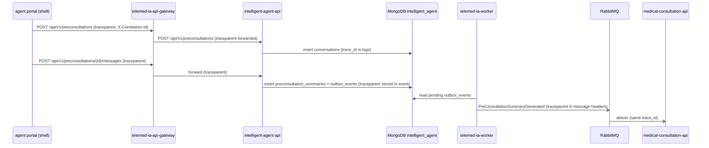

# CP1 - Critical journey and trace map

## Journey
Patient completes an AI pre-consultation (HU-06) before the medical appointment.
Components: telemed-ia-front (agent remote), telemed-ia-api-gateway,
intelligent-agent-api, MongoDB `intelligent_agent`, telemed-ia-worker, RabbitMQ,
medical-consultation-api.

## Hops
| Step | Caller | Receiver | Protocol | Operation | Sync/Async | Data |
|---|---|---|---|---|---|---|
| 1 | agent portal (shell) | telemed-ia-api-gateway | REST | POST /api/v1/preconsultations | sync | none |
| 2 | telemed-ia-api-gateway | intelligent-agent-api | REST | POST /api/v1/preconsultations | sync | conversations, idempotency_records |
| 3 | agent portal (shell) | intelligent-agent-api (via gateway) | REST | POST /api/v1/preconsultations/{id}/messages | sync | messages |
| 4 | intelligent-agent-api | MongoDB rs0 | MongoDB | transaction: preconsultation_summaries + outbox_events | sync | intelligent_agent |
| 5 | telemed-ia-worker | RabbitMQ | AMQP | publish PreConsultationSummaryGenerated | async | queue |
| 6 | medical-consultation-api | RabbitMQ | AMQP | consume PreConsultationSummaryGenerated | async | none |

## Sequence diagram

## Span tree
- `gateway POST /api/v1/preconsultations/{id}/messages` (root)
  - `intelligent-agent-api GeneratePreconsultationSummary`
    - `mongodb transaction preconsultation_summaries + outbox_events`
  - `telemed-ia-worker publish PreConsultationSummaryGenerated` (crosses the async boundary, same trace_id)
    - `medical-consultation-api consume PreConsultationSummaryGenerated`

## How the context crosses the async boundary
The traceparent is saved inside the `outbox_events` document. The worker copies it
into the RabbitMQ message headers, so the consumer continues the same trace.

## Current state
intelligent-agent-api, telemed-ia-worker and RabbitMQ (ADR-011, Proposed) are planned.
The gateway has no agent route yet. The agent portal uses SyntheticAgentService today.