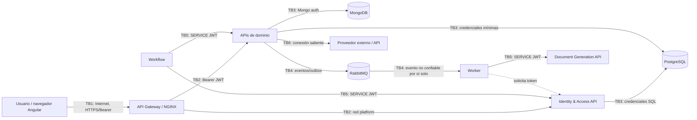

# Week12-Activity2 — Threat Modeling, Security Backlog and CI Security Gates

> **Proyecto:** TeleMed IA — Grupo 2  
> **Asignatura:** Sistemas Distribuidos · Unit 3 · Corte 3  
> **Actividad:** Modelo de amenazas + backlog priorizado + plan de controles de seguridad para CI  
> **Fecha de revisión:** 2026-11-10  
> **Fuentes:** repositorios `code-corhuila/telemed-ia-*`, rama `develop` (salvo `telemed-ia-docs`, rama `main`).  
> **Alcance de la verificación:** inspección de código, documentación, pruebas y workflows existentes en GitHub. **No se ejecutaron las pruebas ni se desplegó la plataforma.**

## 1. Objetivo de la semana

> **This week:** Build a **threat model** (data-flow + trust boundaries + STRIDE), turn findings into a **prioritized security backlog** with testable criteria, and add **security gates** (deps/secrets/authz tests) to CI. **Next week: CI/CD end to end.**

Aplicación a TeleMed IA:

1. Identificar por dónde viajan credenciales, JWT, datos de pacientes, resúmenes médicos y mensajes asíncronos.
2. Marcar los **límites de confianza** (trust boundaries) entre navegador, gateway, microservicios, broker, bases de datos y sistemas externos.
3. Evaluar riesgos con **STRIDE**: *Spoofing, Tampering, Repudiation, Information Disclosure, Denial of Service, Elevation of Privilege*.
4. Convertir riesgos relevantes en historias de seguridad con **responsable, prioridad y criterios verificables**.
5. Distinguir las pruebas que ya existen de los **gates de CI aún no agregados**.

**Convención de estados:**

- **Implementado en código:** existe mecanismo concreto en los repositorios revisados.
- **Parcial / por verificar:** hay una protección, pero faltan garantías, cobertura o una ejecución de CI comprobada.
- **Pendiente:** es una mitigación o un gate propuesto; **no debe reportarse como implementado**.

## 2. Alcance técnico e inventario

Se identificaron **32 repositorios** en la organización del proyecto, agrupados así:

| Capa | Repositorios revisados |
|---|---|
| Gobierno y arquitectura | `telemed-ia-docs`, `ai-telemedicine-chatbot-platform` |
| Entrada y front | `telemed-ia-front`, `telemed-ia-api-gateway`, ocho portales de dominio |
| Servicios de negocio | ocho APIs: `identity-and-access`, `patient-management`, `professional-management`, `intelligent-agent`, `appointment-scheduling`, `medical-consultation`, `notifications`, `document-generation` |
| Procesamiento interno | `telemed-ia-worker`, `telemed-ia-workflow` |
| Persistencia e infraestructura | ocho repositorios `*-db`, `telemed-ia-infra-postgres`, `telemed-ia-infra-mongo` |

**Importante:** las reglas de negocio y de autorización deben ejecutarse en el backend. Los guards de Angular y el gateway no sustituyen las validaciones en cada API.

## 3. Data-flow y límites de confianza

### 3.1 Diagrama del flujo



El diagrama **representa las relaciones y fronteras de seguridad**, no confirma que todos los flujos de negocio estén desplegados de extremo a extremo.

### 3.2 Fronteras y decisiones de seguridad

| ID | Límite de confianza | Datos / operación | Controles identificados | Riesgo residual |
|---|---|---|---|---|
| TB1 | Navegador → Gateway | Contraseña, JWT, datos de formularios | CORS, límite por IP (`20r/s`, ráfaga `10` en `/auth`), ID de correlación | Ataques distribuidos desde muchas IP; TLS de despliegue por verificar |
| TB2 | Gateway → Microservicio | `Authorization: Bearer ...` y peticiones REST | Gateway exige encabezado en rutas protegidas; **cada API debe comprobar firma y permisos** | Implementaciones distintas entre servicios; no confiar en la red |
| TB3 | Microservicio → DB | Datos clínicos, cuentas, tokens, estados | Usuarios/roles separados, migraciones y validadores; control de acceso de PostgreSQL/MongoDB | Segmentación, cifrado y auditoría deben evaluarse por entorno |
| TB4 | Outbox / RabbitMQ → Worker | Eventos de negocio | Idempotencia, reintentos y DLQ donde están implementados | Un evento recibido no autoriza automáticamente acceso a otra API |
| TB5 | Servicio → Servicio | Provisión de cuentas, resúmenes, generación PDF | Tokens M2M RS256 (`role: SERVICE`, `sub` del cliente), allowlists por consumidor | Robo de secreto, autorización débil de `sub`, acceso lateral |
| TB6 | Servicio → tercero | Solicitudes a proveedores externos | Configuración y adaptadores propios | SSRF, fuga de datos, timeout, límites y lista de destinos |
| TB7 | Contenedor interno → endpoints de gestión | Pausa de generación y métricas | Puertos de gestión no publicados al host | Contenedor comprometido podría alcanzar una operación no autenticada |

### 3.3 Dos recorridos representativos

**Inicio de sesión**

1. Angular envía credenciales a `/api/v1/auth/login` por el gateway.
2. NGINX aplica CORS, límites por IP y propaga `X-Correlation-Id`. Las rutas públicas de autenticación **no requieren JWT previo**.
3. `identity-and-access-api` valida los campos, comprueba credenciales con **BCrypt** y emite access/refresh tokens cuando corresponde.
4. Los tokens de usuario son **JWT RS256**. El cliente usa `Authorization: Bearer <token>` en operaciones protegidas.
5. Las APIs receptoras verifican el token y la autorización según rol y, cuando aplica, **propiedad del recurso**.

**Llamada entre servicios — onboarding de profesional**

1. Una persona con rol `ADMIN` llama al `telemed-ia-workflow`.
2. Workflow valida el JWT de entrada y solicita a Identity **su propio token de servicio**.
3. Workflow invoca `/internal/accounts` y `/internal/professionals` con `role: SERVICE`, no reutiliza el JWT del administrador.
4. Identity y Professional Management aplican controles sobre el `sub` permitido; Workflow registra/compensa la saga si algo falla.

**Fuentes:** [Gateway `10-security.conf`](https://github.com/code-corhuila/telemed-ia-api-gateway/blob/develop/nginx/conf.d/10-security.conf), [ruta pública de Identity](https://github.com/code-corhuila/telemed-ia-api-gateway/blob/develop/nginx/routes/identity.conf), [Workflow README](https://github.com/code-corhuila/telemed-ia-workflow/blob/develop/README.md), [ADR-022 M2M](https://github.com/code-corhuila/telemed-ia-docs/blob/main/05-architecture/decisions/records/ADR-022-service-to-service-authentication.md).

## 4. Matriz STRIDE aplicada al proyecto

**Evaluación:** Probabilidad **L** (1 baja, 2 media, 3 alta); impacto **I** (1 bajo, 2 medio, 3 alto); **riesgo = L × I**. Las puntuaciones son una **estimación para priorizar** a partir de los escenarios documentados, no resultados de una prueba de penetración.

| STRIDE | Amenaza concreta y límite | L | I | Riesgo | Evidencia del control existente | Tratamiento requerido |
|---|---|---:|---:|---:|---|---|
| **S — Suplantación** | Credential stuffing sobre `/auth/login` desde IPs distintas (TB1) | 2 | 3 | **6** | BCrypt; entidad `LoginAttempts`, tabla y prueba E2E de bloqueo por cuenta en `develop` | Comprobar ejecución de CI y cobertura del desbloqueo; cerrar issue tras evidencia |
| **S — Suplantación** | Servicio falso obtiene o roba credencial M2M del worker (TB5) | 2 | 3 | **6** | `SERVICE_CLIENTS` guarda hashes bcrypt; service JWT corto; `sub`/rol en consumidores | Límite por `clientId`, rotación, red restringida, pruebas de allowlist |
| **T — Manipulación** | Alterar el JWT (`role: PATIENT` → `ADMIN`) (TB2) | 1 | 3 | **3** | Identity verifica algoritmo RS256, firma, emisor, expiración y claims | Test negativo automatizado de token manipulado y `alg: none` |
| **T — Manipulación** | Evento PDF contiene `patientId` ajeno al `summaryId` (TB4–TB5) | 1 | 3 | **3** | Verificación de correspondencia en la generación documentada en STRIDE | Rechazar incongruencia antes de crear un registro; probar no-fuga |
| **R — Repudio** | Admin cambia el estado de una cuenta y niega la acción (TB2–TB3) | 2 | 2 | **4** | Logs con `X-Correlation-Id`; validación `ADMIN` | Auditoría duradera: actor `sub`, recurso, cambio, instante, resultado |
| **I — Divulgación** | `/auth/register` permite enumerar correos existentes por 409 (TB1) | 3 | 2 | **6** | Password recovery usa respuesta neutral; registro todavía expone conflicto | Respuesta que no revele existencia; actualizar contrato y probar igualdad |
| **I — Divulgación** | IDOR: un paciente consulta cita/documento ajeno cambiando ID (TB2) | 2 | 3 | **6** | Tests de ownership en Appointment; `DocumentQueryService` comprueba propietario | Mantener regresiones de propietario en **cada** recurso sensible |
| **D — Denegación** | Muchas IPs saturan bcrypt del servicio de auth (TB1) | 2 | 3 | **6** | Límite por IP `gateway_per_ip`, timeout | Límite **global** adicional para `/auth`, alerta y smoke de ráfaga |
| **D — Denegación** | Worker o servicio vecino inunda `/api/documents/generate` (TB5) | 2 | 2 | **4** | Idempotencia y límites de concurrencia descritos en STRIDE | Rate limit interno por `sub` y bloqueo de duplicados por `summaryId` |
| **E — Elevación** | `PATIENT` intenta cambiar estado de usuarios `ADMIN` (TB2) | 1 | 3 | **3** | 401 sin token válido; 403 por rol incorrecto en Auth API | Regresión negativa obligatoria en CI |
| **E — Elevación** | Contenedor interno pausa la generación por endpoint de gestión (TB7) | 2 | 2 | **4** | Puerto management no publicado al host | Autenticar operación de pausa o aislarla en red de gestión |

**Nota de exactitud:** el repositorio central `05-architecture/security-threat-model.md` presenta controles como “pending” desde una etapa anterior. Para el estado actual se privilegian **código y pruebas** sobre descripciones antiguas.

**Fuentes de los escenarios:** [STRIDE Auth](https://github.com/code-corhuila/telemed-ia-docs/blob/main/05-architecture/security/stride-JulianaFerro1428.md), [STRIDE Worker → Document](https://github.com/code-corhuila/telemed-ia-docs/blob/main/05-architecture/security/stride-Sofialjure.md), [STRIDE Medical → DB](https://github.com/code-corhuila/telemed-ia-docs/blob/main/05-architecture/security/stride-BondrewdXD.md).

## 5. Backlog de seguridad priorizado para MVP 3

### 5.1 Reglas de prioridad

- **P0:** exposición crítica de pacientes, identidad de servicios o disponibilidad esencial; prioridad inmediata aunque el riesgo calculado sea 6.
- **P1:** riesgo alto, mitigación necesaria antes de considerar MVP 3 seguro.
- **P2:** endurecimiento y trazabilidad, dentro del sprint si hay capacidad.
- **P3:** mejora preventiva de largo plazo.

**No se asignan personas sin confirmación:** el dueño propuesto es el repositorio/equipo responsable del componente.

| Prioridad | Historia de seguridad | Issue | Dueño técnico propuesto | Criterios de aceptación (verificables) | Estado observado |
|---|---|---|---|---|---|
| **P0** | Solo el worker autorizado puede solicitar generación PDF con un token `SERVICE` | [docs#149](https://github.com/code-corhuila/telemed-ia-docs/issues/149) | Document API + Identity + Infra | `sub` fuera de allowlist → **403** sin nueva fila; JWT inválido → **401**; contenedor no autorizado sin acceso; secretos no expuestos | Issue **abierto**; parte de validación implementada, red/gates pendientes |
| **P0** | Bloquear ataques repetidos de login por cuenta, no solo por IP | [docs#152](https://github.com/code-corhuila/telemed-ia-docs/issues/152) | Identity API + DB | 5 errores/15 min → siguiente intento **429**, incluso desde otra IP; bloqueo temporal 1/5/15 min; recuperación disponible; pruebas en CI | Código, tabla y E2E presentes; issue **abierto**; validar ejecución y cierre |
| **P1** | Evitar enumeración de emails/documentos en registro | [docs#153](https://github.com/code-corhuila/telemed-ia-docs/issues/153) | Identity API + Portal | Registro nuevo y duplicado responden de modo indistinguible; no duplica usuario; contrato OpenAPI y tests actualizados | **Pendiente**, issue abierto |
| **P1** | Límite global en `/api/v1/auth` además del límite por IP | [docs#154](https://github.com/code-corhuila/telemed-ia-docs/issues/154) | Gateway | Una ráfaga desde varios orígenes genera **429** en `/auth`, otras rutas siguen funcionando y el log contabiliza el evento | **Pendiente**, issue abierto |
| **P1** | Limitar generación PDF por cliente interno | [docs#150](https://github.com/code-corhuila/telemed-ia-docs/issues/150) | Document API | Exceder N solicitudes/min por `sub` → **429** y `Retry-After`; repetir idempotency key no duplica; `summaryId` repetido con otra key → conflicto | **Pendiente**, issue abierto |
| **P1** | Corregir autorización de endpoint de gestión `generation` | [STRIDE Worker/Doc](https://github.com/code-corhuila/telemed-ia-docs/blob/main/05-architecture/security/stride-Sofialjure.md) | Document API + Infra | Llamada sin credencial a operación de pausa → **401/403** o conexión bloqueada por red de administración; smoke automático | **Pendiente** en análisis STRIDE |
| **P1** | Homogeneizar validación fuerte de JWT en servicios | [Medical JWT](https://github.com/code-corhuila/telemed-ia-medical-consultation-api/blob/develop/internal/infrastructure/adapters/inbound/http/jwt.go) | Cada API | Rechazar token sin `exp`/`sub`/`role`, emisor no válido y algoritmo diferente de **RS256**; pruebas negativas | **Parcial**: verificadores no idénticos; revisar especialmente Medical |
| **P1** | Incorporar gates de secretos, dependencias y authz a cada API | [Identity CI](https://github.com/code-corhuila/telemed-ia-identity-and-access-api/blob/develop/.github/workflows/ci.yml) | Dueño de cada repo | PR bloqueado por hallazgo grave o test 401/403 fallido; workflow registrado como required check | **Propuesta, no añadida** |
| **P2** | Auditoría de cambios administrativos y datos clínicos | [STRIDE Auth](https://github.com/code-corhuila/telemed-ia-docs/blob/main/05-architecture/security/stride-JulianaFerro1428.md) | Identity/Consultation | Registrar `actorSub`, acción, recurso, anterior/nuevo, timestamp, correlationId; **sin PII ni secretos** | **Parcial** (logs, no auditoría completa demostrada) |
| **P2** | Endurecer destinos salientes y TLS entre servicios | [Security policy](https://github.com/code-corhuila/telemed-ia-docs/blob/main/00-governance/security-policy.md) | Infra + APIs | Destinos permitidos; HTTPS/TLS en entorno objetivo; pruebas de red y configuración | **Por verificar / futuro**; mTLS no es mecanismo M2M elegido actualmente |

### 5.2 Historias listas para convertir en issues

**Historia A — Gate de secretos (P1)**  
Como responsable de seguridad quiero que todo PR ejecute una detección de secretos, para impedir que un token, contraseña o llave se suba al repositorio.

- **AC-1:** Un secreto falso de prueba en una rama desechable genera un hallazgo y el job falla.
- **AC-2:** Un PR sin hallazgos supera el job.
- **AC-3:** La regla aplica a `develop`, `qa` y `main`; se valida el historial/rango del PR según la herramienta.
- **AC-4:** El reporte nunca imprime el valor íntegro de un secreto real.

**Historia B — Dependencias vulnerables (P1)**  
Como mantenedor quiero un análisis de dependencias en PR para detectar CVE conocidas antes del merge.

- **AC-1:** Una dependencia de prueba con vulnerabilidad conocida de severidad `high`/`critical` provoca fallo según la política.
- **AC-2:** El reporte contiene paquete, versión, CVE/OSV y alternativa de actualización cuando exista.
- **AC-3:** Falsos positivos y excepciones requieren una justificación registrada y vencimiento.

**Historia C — Regresión de autorización (P1)**  
Como paciente quiero que nadie acceda a mis datos modificando identificadores, incluso con un JWT válido.

- **AC-1:** Sin token → **401**.
- **AC-2:** Token autenticado sin rol permitido → **403**.
- **AC-3:** Paciente A solicitando la cita/documento de B → **403** (o **404**, cuando el contrato oculte existencia); no entrega datos privados.
- **AC-4:** La prueba se ejecuta en el PR y es un **check requerido**, no una prueba manual.

## 6. CI: controles existentes versus gates faltantes

| Repositorio | Evidencia de CI actual | Seguridad ya cubierta | Gate adicional recomendado |
|---|---|---|---|
| [Identity API](https://github.com/code-corhuila/telemed-ia-identity-and-access-api/blob/develop/.github/workflows/ci.yml) | `mvn -B verify` + migraciones oficiales | Tests de auth/JWT, BCrypt, lock y control administrativo presentes en el código | Secret scan, análisis CVE, confirmación de E2E y required checks |
| [Gateway](https://github.com/code-corhuila/telemed-ia-api-gateway/blob/develop/.github/workflows/ci.yml) | `nginx -t` + `tests/smoke.sh` | Smokes de 401/CORS/correlation; configuración | Prueba de ráfaga global, secret scan y check de config |
| [Patient API](https://github.com/code-corhuila/telemed-ia-patient-management-api/blob/develop/.github/workflows/ci.yml) | `mvn clean verify` | `PatientControllerAuthorizationIT` y `Rs256VerifierTest` existen | Confirmar inclusión de IT; CVE + secrets |
| [Professional API](https://github.com/code-corhuila/telemed-ia-professional-management-api/blob/develop/.github/workflows/ci.yml) | `mvn -B verify` | Validación RS256 y roles en API | Secret/dependency scan; 403 en rutas internas |
| [Intelligent Agent API](https://github.com/code-corhuila/telemed-ia-intelligent-agent-api/blob/develop/.github/workflows/ci.yml) | `mvn -B verify`, construcción de imagen | `AgentSecurityTest` y Spring Security en el repositorio | Secret/dependency scan; IDOR en conversaciones |
| [Appointment API](https://github.com/code-corhuila/telemed-ia-appointment-scheduling-api/blob/develop/tests/adapter/inbound/http/test_ownership.py) | No se encontró `.github/workflows/` en `develop` durante esta consulta | `test_auth.py` y `test_ownership.py` definidos | **Crear workflow** para pytest de autenticación/propiedad + deps/secrets |
| [Medical Consultation API](https://github.com/code-corhuila/telemed-ia-medical-consultation-api/blob/develop/.github/workflows/ci.yml) | `go vet`, `go build`, `go test -race` | Pruebas y middleware JWT | Go vulnerability scan, secretos y negativos de claims |
| [Document API](https://github.com/code-corhuila/telemed-ia-document-generation-api/blob/develop/.github/workflows/ci.yml) | `mvn -B verify` | Tests de convenciones; autorizaciones en lógica | Tests de allowlist/management; deps/secrets |
| [Workflow](https://github.com/code-corhuila/telemed-ia-workflow/blob/develop/.github/workflows/ci.yml) | `mvn -B verify` + pruebas DB | JWT propio y service tokens en código | Secret/dependency scan y abuso de saga |
| [Infra Mongo](https://github.com/code-corhuila/telemed-ia-infra-mongo/blob/develop/.github/workflows/ci.yml) | Arranque autenticado y pruebas negativas | Acceso anónimo y credenciales erróneas rechazados | Secret scan y revisión de imágenes/config |

**Conclusión de la inspección:** los workflows principales **ya ejecutan pruebas**, y existen pruebas de autorización específicas, pero **no se confirmó un conjunto integral y obligatorio de escaneo de secretos, dependencias y authz en todos los repositorios**. No afirmar que estos gates están instalados ni que los workflows pasan hasta revisar una ejecución real.

### 6.1 Ejemplo de workflow propuesto para `telemed-ia-identity-and-access-api`

> **Propuesta para implementar**, **no commit realizado**. Crear `.github/workflows/security-gates.yml` en el repositorio objetivo; adaptar el job de pruebas a cada lenguaje y comprobar requisitos/permisos de las acciones. Un gate solo bloquea merges cuando GitHub lo configura como **required status check**.

```yaml
name: Security Gates

on:
  pull_request:
    branches: [develop, qa, main]
  workflow_dispatch:

permissions:
  contents: read

jobs:
  secret-scan:
    name: Secret scanning
    runs-on: ubuntu-latest
    steps:
      - uses: actions/checkout@v4
        with:
          fetch-depth: 0
      - name: Scan for secrets
        uses: gitleaks/gitleaks-action@v2
        env:
          GITHUB_TOKEN: ${{ secrets.GITHUB_TOKEN }}

  dependency-review:
    name: Dependency risk review
    if: github.event_name == 'pull_request'
    runs-on: ubuntu-latest
    permissions:
      contents: read
      pull-requests: read
    steps:
      - uses: actions/checkout@v4
      - name: Review new vulnerable dependencies
        uses: actions/dependency-review-action@v4
        with:
          fail-on-severity: high

  authz-regression:
    name: Authn/authz regression tests
    runs-on: ubuntu-latest
    steps:
      - uses: actions/checkout@v4
      - name: Checkout official Identity DB migrations
        uses: actions/checkout@v4
        with:
          repository: code-corhuila/telemed-ia-identity-and-access-db
          ref: 0241b20d7141833f332490c8cb7bfd00dd54abdd
          path: .e2e/identity-db
          persist-credentials: false
      - uses: actions/setup-java@v4
        with:
          distribution: temurin
          java-version: '21'
          cache: maven
      - name: Execute full verify, including security tests
        env:
          IDENTITY_DB_MIGRATIONS_DIR: ${{ github.workspace }}/.e2e/identity-db
        run: mvn -B verify
```

**Consideraciones antes del merge:**

- `gitleaks/gitleaks-action@v2` debe validarse según las condiciones de uso/licencia y los permisos de la organización. No instalar acciones de terceros sin revisión de seguridad; fijar SHA de las acciones cuando se aprueben.
- `dependency-review-action` examina **cambios de dependencias en PR**, no garantiza detección de vulnerabilidades heredadas del árbol completo. Complementarlo con un análisis completo periódico por ecosistema (por ejemplo Maven/Go/Python/npm) y una política de falsos positivos.
- Los tests de autorización forman un gate solo si se incluyen en el comando de CI y el build **falla** cuando falla alguna aserción. Verificar si Maven Surefire/Failsafe ejecuta cada prueba `*IT` y `*E2ETest` prevista.
- En cada repositorio comprobar que la rama destino tiene protección y exige los jobs `Secret scanning`, `Dependency risk review` y `Authn/authz regression tests` (o sus nombres acordados).
- Guardar como evidencia un run correcto y una **prueba negativa** que haga fallar deliberadamente cada gate, sin subir secretos reales.

### 6.2 Matriz mínima de pruebas negativas

| Prueba | Resultado esperado | Ejemplo real / ubicación |
|---|---|---|
| Llamada protegida sin Bearer | 401 | [`PatientControllerAuthorizationIT`](https://github.com/code-corhuila/telemed-ia-patient-management-api/blob/develop/patient-app/src/test/java/com/telemedai/patient/infrastructure/adapters/in/rest/PatientControllerAuthorizationIT.java) |
| JWT manipulado / malformado | 401 | [`JwtAccessTokenVerifierTest`](https://github.com/code-corhuila/telemed-ia-identity-and-access-api/blob/develop/identity-and-access-adapters/src/test/java/com/telemed/identityaccess/adapter/out/security/JwtAccessTokenVerifierTest.java) |
| Rol no autorizado en `/admin/accounts` | 403 | [`AdminAccountsControllerTest`](https://github.com/code-corhuila/telemed-ia-identity-and-access-api/blob/develop/identity-and-access-adapters/src/test/java/com/telemed/identityaccess/adapter/in/http/AdminAccountsControllerTest.java) |
| Paciente A lee cita de B | 403 | [`test_ownership.py`](https://github.com/code-corhuila/telemed-ia-appointment-scheduling-api/blob/develop/tests/adapter/inbound/http/test_ownership.py) |
| Paciente A lee documento de B | denegar sin datos | [`DocumentQueryService`](https://github.com/code-corhuila/telemed-ia-document-generation-api/blob/develop/document-generation-core/src/main/java/co/edu/corhuila/telemedia/documentgeneration/application/usecase/DocumentQueryService.java) |
| Login tras 5 fallos por cuenta | 429 | [`LoginAccountLockE2ETest`](https://github.com/code-corhuila/telemed-ia-identity-and-access-api/blob/develop/identity-and-access-app/src/test/java/com/telemed/identityaccess/LoginAccountLockE2ETest.java) |
| `SERVICE` de cliente fuera de allowlist | 403, sin mutación | **Agregar / verificar test end-to-end** de Document Generation |
| Secreto de prueba detectado en PR | job falla | **Agregar gate** de Gitleaks |
| Dependencia nueva de severidad alta | job falla | **Agregar gate** de Dependency Review |

## 7. Evidencias existentes (rutas de código)

| Control | Ruta verificable |
|---|---|
| Validación de JWT RS256 en Identity | [`identity-and-access-adapters/.../JwtAccessTokenVerifier.java`](https://github.com/code-corhuila/telemed-ia-identity-and-access-api/blob/develop/identity-and-access-adapters/src/main/java/com/telemed/identityaccess/adapter/out/security/JwtAccessTokenVerifier.java) |
| Contraseñas BCrypt | [`identity-and-access-adapters/.../BCryptPasswordHasher.java`](https://github.com/code-corhuila/telemed-ia-identity-and-access-api/blob/develop/identity-and-access-adapters/src/main/java/com/telemed/identityaccess/adapter/out/security/BCryptPasswordHasher.java) |
| Lockout por cuenta y plazo | [`identity-and-access-core/.../LoginAttempts.java`](https://github.com/code-corhuila/telemed-ia-identity-and-access-api/blob/develop/identity-and-access-core/src/main/java/com/telemed/identityaccess/domain/model/LoginAttempts.java) |
| Persistencia de intentos | [`identity-and-access-db/01_ddl/03_tables/007_create_login_attempts.sql`](https://github.com/code-corhuila/telemed-ia-identity-and-access-db/blob/develop/01_ddl/03_tables/007_create_login_attempts.sql) |
| Emisión de service tokens | [`ServiceTokenConfiguration.java`](https://github.com/code-corhuila/telemed-ia-identity-and-access-api/blob/develop/identity-and-access-app/src/main/java/com/telemed/identityaccess/app/config/ServiceTokenConfiguration.java) |
| Secretos M2M guardados como hash | [`ConfiguredServiceClients.java`](https://github.com/code-corhuila/telemed-ia-identity-and-access-api/blob/develop/identity-and-access-adapters/src/main/java/com/telemed/identityaccess/adapter/out/security/ConfiguredServiceClients.java) |
| Reglas de roles en agente | [`SecurityConfiguration.java`](https://github.com/code-corhuila/telemed-ia-intelligent-agent-api/blob/develop/intelligent-agent-app/src/main/java/com/telemed/intelligentagent/app/config/SecurityConfiguration.java) |
| Validación JWT en FastAPI | [`appointment/.../auth.py`](https://github.com/code-corhuila/telemed-ia-appointment-scheduling-api/blob/develop/src/appointment/adapter/inbound/http/auth.py) |
| Validación JWT en Go | [`medical-consultation-api/.../jwt.go`](https://github.com/code-corhuila/telemed-ia-medical-consultation-api/blob/develop/internal/infrastructure/adapters/inbound/http/jwt.go) |
| Autorización por propietario del PDF | [`DocumentQueryService.java`](https://github.com/code-corhuila/telemed-ia-document-generation-api/blob/develop/document-generation-core/src/main/java/co/edu/corhuila/telemedia/documentgeneration/application/usecase/DocumentQueryService.java) |
| Políticas y modelo de amenazas | [`security-policy.md`](https://github.com/code-corhuila/telemed-ia-docs/blob/main/00-governance/security-policy.md), [`security-threat-model.md`](https://github.com/code-corhuila/telemed-ia-docs/blob/main/05-architecture/security-threat-model.md) |

## 8. Definition of Done (DoD) propuesta para MVP 3

- [x] Modelo STRIDE general y análisis de fronteras específicos documentados en `telemed-ia-docs`.
- [x] Controles de autenticación y autorización demostrables en distintas APIs.
- [x] Mecanismo M2M acordado mediante **ADR-022** y presente en servicios revisados.
- [x] Ejemplos de pruebas negativas de JWT/roles/propiedad del recurso disponibles.
- [x] Issues de seguridad priorizados en el backlog (#149, #150, #152, #153, #154).
- [ ] Validar estado de los issues frente al código, ejecutar CI y adjuntar logs/runs.
- [ ] Completar remediaciones P0 y P1 o registrar aceptación formal y justificada del riesgo.
- [ ] Integrar el **gate de secretos** y demostrar que bloquea un PR inseguro.
- [ ] Integrar el **gate de dependencias** y demostrar que bloquea una CVE de severidad acordada.
- [ ] Asegurar **authz tests** en CI para APIs sensibles y configurar required status checks.
- [ ] Completar cobertura de TB5/TB7, seguridad de rutas internas y protección de gestión.
- [ ] Registrar responsables, evidencias y decisiones de riesgo residual en issues/PR.

## 9. Próxima semana: CI/CD end to end

El entregable de esta actividad **define qué debe impedir un merge inseguro**. En la siguiente sesión de CI/CD end-to-end se deberá comprobar el flujo completo:

```text
Cambio de código / PR
        ↓
Build + unit/integration tests
        ↓
Security gates: secrets + dependency risk + authz
        ↓
Revisión de PR / required status checks
        ↓
Build de imagen / artefacto
        ↓
Despliegue a ambiente autorizado
        ↓
Smoke + comprobación de rutas y permisos
        ↓
Evidencia de ejecución y decisión de promoción
```

**Nota final:** este archivo es un **análisis y propuesta de seguridad**, no una prueba de despliegue ni un cambio automático de workflows. Los controles señalados como *pendientes* requieren PR, ejecución y evidencia antes de pasar a *implementado*.
