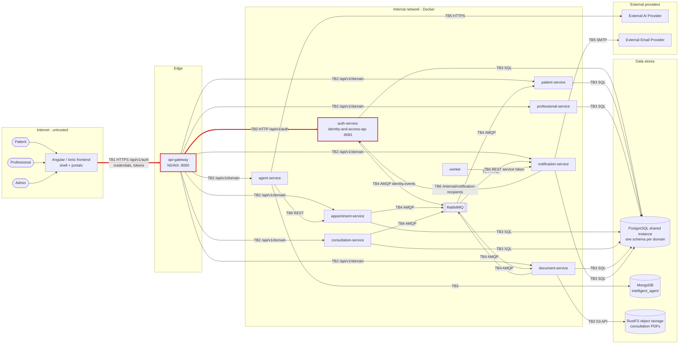

# CP1 · Attack surface map — TeleMed IA

My boundary: **Internet → `api-gateway` → `auth-service` (`/api/v1/auth`)** — claim issue
[telemed-ia-docs#139](https://github.com/code-corhuila/telemed-ia-docs/issues/139).

Sources in `telemed-ia-docs`: `09-microservices/service-catalog.md`,
`09-microservices/services/02-auth-service/`, `05-architecture/decisions/` (ADR-005, ADR-007,
ADR-011, ADR-021, ADR-022).

## 1. Data-flow diagram

My boundary is the red path (TB1 + TB2 for the `/api/v1/auth` route only).

| TB | Trust boundary | Owner |
|---|---|---|
| TB1 | Internet (browser) → `api-gateway` | **me, only `/api/v1/auth`** |
| TB2 | `api-gateway` → backend services | **me, only `api-gateway` → `auth-service`** |
| TB3 | Service → its data store (PostgreSQL, MongoDB, RustFS) | — |
| TB4 | Service ↔ RabbitMQ (domain events) | — |
| TB5 | Service → external provider (AI, email) | — |
| TB6 | Service → service (internal REST, ADR-022 service tokens) | — |

## 2. Asset inventory (Identity & Access domain)

| # | Asset | Where it lives | Classification |
|---|---|---|---|
| 1 | Password (plain text) and `password_hash` (BCrypt) | Request body of `POST /login` and `/register` in transit; table `users` | Restricted |
| 2 | RS256 private signing key | `auth-service` runtime configuration only | Restricted |
| 3 | Refresh token (raw) and `token_hash` (SHA-256) | Browser and request body of `/refresh` and `/logout`; table `refresh_tokens` | Restricted |
| 4 | Password-reset token and `resetUrl` | Email link and body of `POST /password-reset`; table `password_reset_tokens` (hash only) | Restricted |
| 5 | Access token (JWT with `sub` UUID and `role`) | Browser session and `Authorization` header | Confidential |
| 6 | User PII: `full_name`, `email`, `identity_document` | Table `users`; responses of `/admin/accounts` | Confidential |
| 7 | Technical roles `PATIENT`, `PROFESSIONAL`, `ADMIN` | Table `roles`; `role` claim of the JWT | Internal |
| 8 | Gateway access log with `correlationId` and client IP | `api-gateway` JSON access log | Internal |
| 9 | Auth API contract (`/api/v1/auth` endpoints) | `07-api/contracts/openapi/` in `telemed-ia-docs` | Public |

## 3. Entry points of my boundary

Public port: `api-gateway` `:8000`. The gateway does not validate tokens (ADR-005); it applies CORS,
a per-IP rate limit (`20r/s`, `burst=10` on this route) and `X-Correlation-Id`, then proxies to
`auth-service` `:8081`, which validates the RS256 token itself.

| Entry point | Who calls it | How it authenticates today |
|---|---|---|
| `POST /api/v1/auth/register` | Anonymous visitor (new patient) | None (public) |
| `POST /api/v1/auth/login` | Patient, professional, admin | None; email + password in body |
| `POST /api/v1/auth/refresh` | Logged-in frontend | Refresh token in body |
| `POST /api/v1/auth/logout` | Logged-in frontend | Refresh token in body |
| `GET /api/v1/auth/session` | Logged-in frontend | Bearer access token (RS256) |
| `POST /api/v1/auth/password-recovery` | Anonymous user who forgot the password | None; email in body |
| `POST /api/v1/auth/password-reset` | User who opened the `resetUrl` | Reset token in body |
| `GET /api/v1/auth/admin/accounts`, `GET /{id}`, `PUT /{id}/status` | Admin portal | Bearer token, `role = ADMIN` (else 403) |

Out of my boundary: `/internal/accounts`, `/internal/notification-recipients/{id}` and
`/internal/service-token` are not routed by `api-gateway` (its identity route only matches
`/api/v1/auth`); they belong to TB6. The management port `:9081` must not be published.
