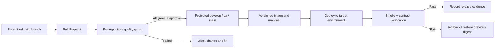
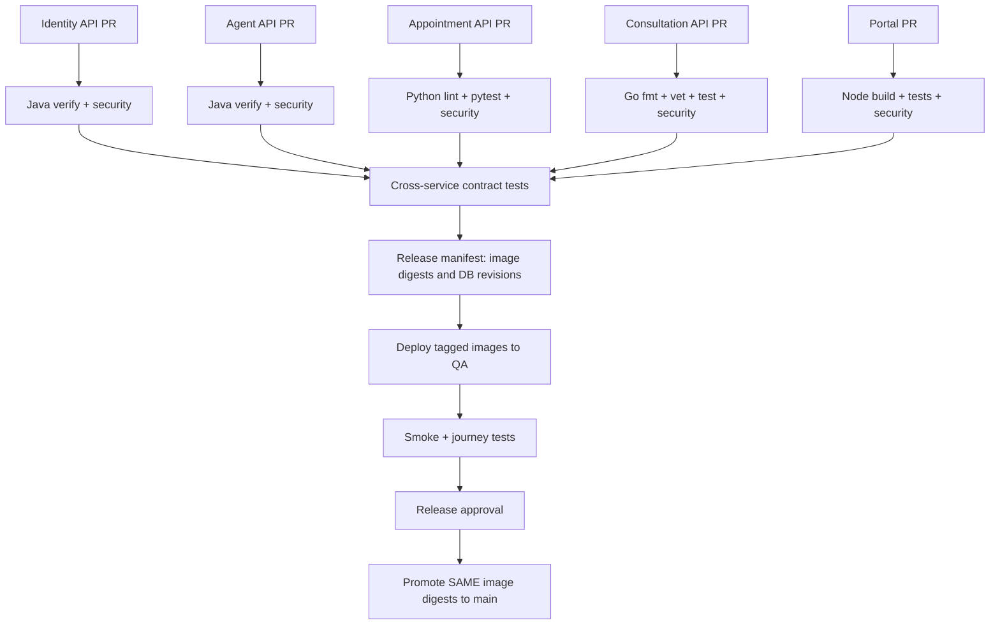

# TeleMed IA — CI/CD, Quality Gates and MVP 3 Planning

> **Unit 3 · Weekly + Planning · Corte 3**  
> **Project:** TeleMed IA — Grupo 2  
> **Reviewed:** November 10, 2026  
> **Repository organization:** [code-corhuila](https://github.com/code-corhuila)  
> **Basis:** current repository files and workflows (primarily code repositories' `develop` branch; documentation repository's `main` branch).

## This week

Set up your CI/CD: PRs run **build + lint + type + tests + coverage + security** as blocking gates; **protect main**; automate deployment of the tagged image. Session 2 (planning) maps your DoD to these gates and slices the pipeline stories for MVP 3.

This README compares the **target described by the class** with **the implementation observed in TeleMed IA**. A proposed gate or deployment below is **not** considered implemented merely because it appears in this document.

## 1. Objectives and status

| Objective | Evidence found | Current assessment |
|---|---|---|
| CI on Pull Requests | Several `.github/workflows/ci.yml` workflows target `develop`, `qa`, `main` | **Configured in many repos**, but execution is reportedly blocked by organizational billing (see §8) |
| Build and tests | Java Maven, Go, frontend, gateway and database test jobs | **Implemented in several repos**; breadth varies by stack |
| Lint and formatting | Go `gofmt`, `go vet`; Python has Ruff configuration | **Partial**; no uniform blocking lint check across stacks |
| Type checks | Java/Go builds and Angular production build | **Partially implicit**; a distinct strict TypeScript gate is not established in inspected workflows |
| Unit, integration, contract | Automated test suites and database checks; some integration tests skip without their environment | **Partial**; must require and verify critical integration/contract tests |
| Coverage floor | DoD says coverage cannot fall without justified approval; testing strategy defines no fixed percentage | **Not established as a universal blocking gate** |
| Dependency, secret, SAST scanning | Security policies require these controls, but sampled primary CI files do not run them | **Proposed for MVP 3, not verified as blocking** |
| Branch protection | Team rules prohibit direct commits and require PR reviews | **Documented**; effective GitHub settings/status-check enforcement not independently verified |
| Tagged image publication | Some workflows build an image; platform relies on Docker Compose | **Not yet a shared versioned registry/release process** |
| Automatic deployment of tagged image | Current documentation says no hosted deployment and no registry | **Pending** |

**Interpretation:** A GitHub Actions YAML file does not by itself prove that checks have executed successfully, that branch protection requires them, or that a release deployed.

## 2. Architecture: what the pipeline must deliver

TeleMed IA uses multiple repositories and independently deployed components:

- **Frontend:** `telemed-ia-front` (Angular shell) plus domain portals.
- **Gateway:** `telemed-ia-api-gateway` (NGINX).
- **Java APIs:** Identity & Access, Patient Management, Professional Management, Intelligent Agent, Notifications and Document Generation.
- **Other APIs:** Appointment Scheduling (Python/FastAPI) and Medical Consultation (Go).
- **Background components:** `telemed-ia-worker` and `telemed-ia-workflow`.
- **Databases:** domain-owned `-db` migration repositories, with PostgreSQL and MongoDB infrastructure.
- **Runtime:** Docker Compose, external `platform` network and environment-specific configuration.

Each repository must verify its own change before integration. A system-level release must then verify that **compatible versions across the repositories** work together.



**Important course-specific rule:** Changes are *not* promoted by directly merging `develop` into `qa` or `qa` into `main`. Instead, a child branch is created from the **target** branch and reviewed changes are re-applied with `git cherry-pick -x`, then introduced by PR. Release branches come from `main`. See [branching-policy.md](https://github.com/code-corhuila/telemed-ia-docs/blob/main/00-governance/branching-policy.md).

## 3. Actual CI commands and evidence by component

| Component / repository | Confirmed workflow or evidence | Currently checked / important gap |
|---|---|---|
| [Identity & Access API](https://github.com/code-corhuila/telemed-ia-identity-and-access-api/blob/develop/.github/workflows/ci.yml) | `.github/workflows/ci.yml` | Java 21; `mvn -B verify`, official DB migrations at pinned commit; no separate scanning steps in this file |
| [Professional Management API](https://github.com/code-corhuila/telemed-ia-professional-management-api/blob/develop/.github/workflows/ci.yml) | `.github/workflows/ci.yml` | Java 21; `mvn -B verify`; no explicit coverage/security scan stage |
| [Intelligent Agent API](https://github.com/code-corhuila/telemed-ia-intelligent-agent-api/blob/develop/.github/workflows/ci.yml) | `.github/workflows/ci.yml` | Java 21; `mvn -B verify` and local Docker image build tagged `:ci`, but no registry push |
| [Notifications API](https://github.com/code-corhuila/telemed-ia-notifications-api/blob/develop/.github/workflows/ci.yml) | `.github/workflows/ci.yml` | Java 21; `mvn -B verify` with official DB migrations at pinned commit |
| [Document Generation API](https://github.com/code-corhuila/telemed-ia-document-generation-api/blob/develop/.github/workflows/ci.yml) | `.github/workflows/ci.yml` | Java 21; `mvn -B verify`; security/coverage gates not separately present |
| [Patient Management API](https://github.com/code-corhuila/telemed-ia-patient-management-api/blob/develop/.github/workflows/ci.yml) | `.github/workflows/ci.yml` | Java **17** currently; `mvn ... clean verify` and test report artifact. Align target runtime with actual service before changing CI |
| [Medical Consultation API](https://github.com/code-corhuila/telemed-ia-medical-consultation-api/blob/develop/.github/workflows/ci.yml) | `.github/workflows/ci.yml` | Go **1.25**; `gofmt`, `go vet`, `go build`, `go test -race -count=1 ./...` |
| [Appointment Scheduling API](https://github.com/code-corhuila/telemed-ia-appointment-scheduling-api/blob/develop/pyproject.toml) | `pyproject.toml` + [README](https://github.com/code-corhuila/telemed-ia-appointment-scheduling-api/blob/develop/README.md) | Python 3.12 with pytest/Ruff available; **no CI workflow found in inspected `develop`**; tests requiring `TEST_DATABASE_URL` are not yet in CI |
| [Angular shell](https://github.com/code-corhuila/telemed-ia-front/blob/develop/.github/workflows/ci.yml) | `.github/workflows/ci.yml` | Node 22; `npm ci`, `npm run test:ci`, `npm run build`; no explicit lint/coverage/scanner step |
| [API Gateway](https://github.com/code-corhuila/telemed-ia-api-gateway/blob/develop/.github/workflows/ci.yml) | `.github/workflows/ci.yml` | Build/start container, `nginx -t`, and `tests/smoke.sh` |
| [Workflow orchestration](https://github.com/code-corhuila/telemed-ia-workflow/blob/develop/.github/workflows/ci.yml) | `.github/workflows/ci.yml` | Java 21 `mvn -B verify` plus dedicated PostgreSQL/Liquibase schema tests |
| Domain DB repositories | Individual `.github/workflows/db-ci.yml` | Migration, rollback and rebuild tests; retain these checks as mandatory when schemas change |

**Caution on test results:** Integration tests can be **skipped** when required infrastructure variables are absent. Do not count “0 failed, 10 skipped” as proof of full integration coverage. The [testing strategy](https://github.com/code-corhuila/telemed-ia-docs/blob/main/11-quality/testing-strategy.md) explicitly distinguishes these cases.

## 4. Session 2: Definition of Done (DoD) → automated gates

Project source: [Definition of Done](https://github.com/code-corhuila/telemed-ia-docs/blob/main/00-governance/definition-of-done.md).

| DoD criterion | Target gate | Failure condition | Status |
|---|---|---|---|
| Code compiles and runs | `build` | Compilation or image build exits non-zero | Existing for many repositories |
| Code style and formatting | `lint-format` | Formatter/linter finds violations | Partial |
| Type safety | `typecheck` | TypeScript/static checks fail | Needs explicit standardization |
| Unit tests | `unit-tests` | Any mandatory unit test fails | Existing for many repositories |
| Integration with real DB/broker | `integration-tests` | Required integration test fails or is unexpectedly skipped | Partial |
| API and event compatibility | `contract-tests` | Consumer/provider contract is incompatible | Partial; cross-repo orchestration required |
| Coverage does not drop | `coverage` | Measured coverage below approved floor, or prohibited regression | Floor **not defined**; propose and approve baseline |
| Authentication/authorization/ownership | `authz-tests` | Unauthorized request succeeds or ownership is bypassed | Some negative tests exist; expand across domains |
| No exposed secrets | `secret-scan` | Confirmed secret in proposed change/history according to agreed scope | Not present in inspected primary CI YAMLs |
| Known vulnerable dependencies | `dependency-scan` | High/critical findings exceed documented policy | Not present in inspected primary CI YAMLs |
| Static security review | `sast` | Security finding exceeds the agreed severity threshold | Not present in inspected primary CI YAMLs |
| No unresolved placeholders | `no-placeholders` | Forbidden TODO/FIXME or templates in release-scoped files | Proposed, with narrow allowlist to avoid false positives |
| PR reviewed by another person | GitHub branch rule | Required approval absent | Documented; platform enforcement not verified |
| Release smoke test | `smoke` | Gateway `/health` or critical journey fails | Gateway smoke exists; full deployed release smoke pending |

**Coverage policy proposal (not a project fact):** establish the current measured per-repository baseline before setting a numeric threshold; agree a floor (for example 80% on changed business logic, if feasible), and make the checker fail below it. The current project testing strategy does **not** mandate 80% or any universal number.

### Definition of a truly blocking gate

A gate is blocking only if **all three** are true:

1. The gate runs on every relevant PR and exits non-zero on noncompliance.
2. GitHub branch rules list the exact workflow/job status as **required**.
3. A failing, canceled or missing result prevents merge; permissions/bypass controls are reviewed.

A warning-only scanner, an unchecked GitHub Actions job, or a command run manually is **not** a blocking gate.

## 5. Required branch-protection design

### Code repositories

| Branch | Entry method | Required checks (target) | Review / promotion |
|---|---|---|---|
| `develop` | PR from `feat/*`, `fix/*`, `chore/*`, `docs/*` | build, lint, type, unit, integration, contract (as applicable), coverage, security | 1 approval from a different team member; all checks green |
| `qa` | PR from `qa-hu-XX-*` cut from `qa` | same gates + cross-service contract checks | 1 peer approval; apply validated commits with `cherry-pick -x` |
| `main` | PR from `release/<version>` or `hotfix/*` cut from `main` | all mandatory gates + release validation | approval from `@ariel5253`, CODEOWNERS, resolved conversations, dismiss stale approvals |

For **`telemed-ia-docs`**, only `main` is permanent and the teacher's approval applies to its PRs. Source: [Git Conventions](https://github.com/code-corhuila/telemed-ia-docs/blob/main/00-governance/git-conventions.md).

**Configuration to request from an admin:** GitHub **Settings → Rules → Rulesets** (or **Branches**, depending on the repository), target each permanent branch, require PR/review/status checks, disallow direct updates and force pushes, and keep the branch current before merging when supported. Check roles and any bypass permissions. This configuration has **not** been changed or independently verified by this README.

### Example negative validation of branch rules

1. Open a PR where `lint-format` deliberately fails: GitHub must refuse the merge.
2. Open a PR with green jobs but no approval: GitHub must refuse the merge.
3. Try to push directly to protected `main`: GitHub must reject the update.
4. Repair the failing job, obtain the required review and confirm merge becomes available.

Keep screenshots/links to the PR checks and repository rules as evidence for MVP 3.

## 6. Design: independent CI + one traceable system release



Because TeleMed IA is **multi-repo**, each service's workflow already runs only for its repository. Path filtering is most useful **inside a repository that combines independent modules** and in a future **central system-level orchestrator**. Do not add a giant workflow that rebuilds every unrelated repository on every PR. Contract checks need to identify which producer/consumer combinations changed.

**Artifact policy (target):**

- Build the image **once** for an approved release; tag it with the service version and record its immutable digest (`sha256:…`).
- Store the image in a registry such as GitHub Container Registry (**GHCR is a proposed option, not an existing TeleMed IA registry**).
- Store a release manifest listing every service image digest, database migration revision and compatible API contract version.
- Promote **the same digest** through QA to main; do not rebuild the image differently for production.
- Keep runtime secrets outside Git and use separately scoped secrets for each environment.
- Apply only forward-compatible database migrations and define rollback/recovery steps.
- Deploy through a controlled runner/host, wait for health checks, run smoke/contract tests and record the result.

**Existing deployment reality:** the [CI/CD documentation](https://github.com/code-corhuila/telemed-ia-docs/blob/main/10-devops/ci-cd.md) states that the platform has no hosted deployment or container registry and currently runs with `docker compose up --build`. Thus automated deployment of a **tagged, published** image is a **new MVP 3 work item**, not an accomplished capability.

## 7. Proposed pipeline implementation (design, not yet applied)

### 7.1 Gate order and names

```text
Pull Request
  ├─ build
  ├─ lint-format
  ├─ typecheck              (where applicable)
  ├─ unit-tests
  ├─ integration-tests       (real required dependencies)
  ├─ contract-tests
  ├─ coverage
  ├─ secret-scan
  ├─ dependency-scan
  └─ sast
       ↓ ALL REQUIRED GREEN
Human approval + branch protection
       ↓
Merge to protected branch
       ↓
Tag + publish immutable image
       ↓
Controlled environment deployment
       ↓
Smoke + rollback readiness
```

Examples of commands **to wire into jobs only after verifying their configuration in each repository**:

| Stack | Build/tests already available | Extra proposed checks |
|---|---|---|
| Java 21 (except Patient API's current Java 17) | `mvn -B verify` | Maven Checkstyle/Spotless, JaCoCo coverage verify, OWASP Dependency-Check or equivalent, secret scan, SAST |
| Python 3.12 | `pip install -e ".[dev]"`; `python -m pytest` | `ruff check .`, `ruff format --check .`, coverage plugin, dependency audit, secret scan, SAST |
| Go 1.25 | `gofmt -l .`; `go vet ./...`; `go test -race -count=1 ./...` | Coverage verification, `govulncheck` or equivalent, secret scan, SAST |
| Angular/React, Node 22 | `npm ci`; `npm run test:ci`; `npm run build` | Add working lint and strict `tsc --noEmit` scripts as appropriate; coverage, `npm audit`/equivalent, secret scan, SAST |
| NGINX | `nginx -t`; `tests/smoke.sh` | Config/security scan, image scan, secrets check |
| Domain DB | Apply, rollback, rebuild + constraints | Least-privilege tests and destructive-operation negative tests |

Do **not** add `npm run lint`, `make coverage-check` or any other command as a required gate until the script/plugin exists and works. A YAML step containing a nonexistent command is not an implementation plan's completion.

### 7.2 Illustrative release job for one Docker service

The following is a **starter example** for a future `.github/workflows/release.yml`, not a file found in the project. It *publishes* an image when a version tag is pushed; **deployment is a separate job** that needs an authorized deployment runner/host and environment secrets. Do not claim this snippet performs deployment.

```yaml
name: Release image (proposed)
on:
  push:
    tags: ['v*']

permissions:
  contents: read

jobs:
  publish-image:
    runs-on: ubuntu-latest
    permissions:
      contents: read
      packages: write
    steps:
      - uses: actions/checkout@v4
      - uses: docker/setup-buildx-action@v3
      - uses: docker/login-action@v3
        with:
          registry: ghcr.io
          username: ${{ github.actor }}
          password: ${{ secrets.GITHUB_TOKEN }}
      - uses: docker/build-push-action@v6
        with:
          context: .
          file: deploy/Dockerfile
          push: true
          tags: ghcr.io/${{ github.repository }}:${{ github.ref_name }}
```

**Before use:** restrict release tags to protected `main` commits using repository rules/process, choose the approved registry, verify package permissions, pin third-party actions to reviewed full commit SHAs for production hardening, confirm Docker build context, and add a separate environment-protected deploy job that pulls the recorded digest, executes Compose and smoke tests. The publish job should **not** run on untrusted PR code with write permissions.

### 7.3 Deployment checklist for the proposed deploy job

- [ ] Trigger from an approved version/tag and a green release pipeline.
- [ ] Confirm image digest, service version and release manifest.
- [ ] Use a trusted runner or authorized host with environment-scoped credentials.
- [ ] Pull immutable images (avoid `latest`) and apply approved DB migrations.
- [ ] Start or update only affected services; keep previous release available for rollback.
- [ ] Verify gateway `/health`, identity login and at least one protected request per critical domain.
- [ ] Run end-to-end smoke flow: pre-consultation / appointment / consultation / document generation, as supported by the MVP scope.
- [ ] If a check fails, stop promotion and restore the previous compatible release.
- [ ] Preserve logs, image digests, workflow URLs and QA approvals as release evidence.

## 8. Confirmed obstacles and evidence limitations

1. **GitHub Actions billing:** `telemed-ia-docs/10-devops/ci-cd.md` reports that workflows cannot execute because of the organization's billing limit (status documented November 9, 2026). This was **not independently retested**. Until restored, local test logs are evidence, **not** equivalent automated required status checks.
2. **Coverage:** The project [testing strategy](https://github.com/code-corhuila/telemed-ia-docs/blob/main/11-quality/testing-strategy.md) explicitly has **no fixed coverage percentage**. Setting a floor is a new team decision.
3. **Missing Python CI:** The [Appointment Scheduling README](https://github.com/code-corhuila/telemed-ia-appointment-scheduling-api/blob/develop/README.md) documents Ruff and pytest commands, but no `.github/workflows/ci.yml` was found in the inspected `develop` branch.
4. **Skipped integrations:** Some suites require `TEST_DATABASE_URL` or other runtime services and are skipped without them. For critical PR gates, provision disposable test dependencies rather than silently skipping.
5. **Branch controls:** Policy describes required PR reviews and no direct pushes, but **live GitHub ruleset/branch protection configuration was not verified**.
6. **Registry + deployment:** The project currently describes Docker Compose builds, not a hosted registry/deploy workflow. That capability must be implemented before claiming automated CD.
7. **Potential documentation drift:** DevOps overview files are not always synchronized with current repository code. For example, `telemed-ia-workflow` now has `ci.yml` and Medical Consultation's inspected workflow uses Go 1.25. Prefer the current workflow file for implementation status.

## 9. MVP 3 CI/CD backlog — proposed security and delivery stories

Priority scale: **P0** blocks safe delivery, **P1** is required for a trustworthy MVP release, **P2** is a useful hardening/efficiency improvement. IDs below are **proposed local story identifiers**, not pre-existing GitHub issue numbers.

| ID | Priority | Story | Testable acceptance criteria | Suggested ownership |
|---|---|---|---|---|
| `CICD-01` | **P0** | Restore CI execution and publish evidence | A real PR runs GitHub Actions with a completed result; failing test results in red job | Organization admin + DevOps |
| `CICD-02` | **P0** | Add missing Appointment API CI | Python 3.12 workflow runs `ruff check`, format check and pytest; failing test blocks PR after rule is enabled | Appointment API |
| `CICD-03` | **P0** | Enforce branch protection | Direct push to `main` rejected; PR without required green checks or review cannot merge; teacher approval required for `main` | Repository admin |
| `CICD-04` | **P0** | Add mandatory secret/dependency/SAST checks | Test fixture with a detected secret/high-risk finding produces a non-zero job; approved false-positive process documented | Each service owner + DevOps |
| `CICD-05` | **P1** | Enforce coverage and integration gates | Team approves measurable floor per stack; deliberate below-floor change fails; critical integration tests run with real disposable infrastructure | Each API owner |
| `CICD-06` | **P1** | Make authz negative tests mandatory | Invalid token → 401; insufficient role or another user's protected resource → 403 (per contract); PR fails when regression introduced | Domain owners |
| `CICD-07` | **P1** | Publish versioned service images | Green release produces a registry image tagged `vX.Y.Z` with recorded SHA256 digest and no embedded secrets | DevOps + service owner |
| `CICD-08` | **P1** | Deploy a tagged, immutable release to QA | Automated runner pulls exact digest, applies approved migrations, starts Compose and records rollout status | DevOps |
| `CICD-09` | **P1** | Add release smoke tests and rollback | Intentionally broken health check fails release and triggers stop/rollback procedure; evidence includes before/after digest | DevOps + QA |
| `CICD-10` | **P1** | Trace multi-repo release compatibility | Release manifest pins all service image digests, contracts and migrations; cross-service tests run against that combination | Architecture + QA |
| `CICD-11` | **P2** | Optimize CI without dropping tests | Caching and selective jobs cut redundant execution; shared contract/release gates still run when dependencies change | DevOps |
| `CICD-12` | **P2** | Eliminate unreviewed placeholders | Scoped no-TODO/FIXME verification blocks new critical placeholders; approved issue references are exempted only by policy | Team leads |

### Prioritized delivery order

1. **Unblock:** `CICD-01` → `CICD-02` → `CICD-03`, because protection is not meaningful without executable required checks.
2. **Make quality enforceable:** `CICD-04` → `CICD-05` → `CICD-06`.
3. **Ship a reproducible release:** `CICD-07` → `CICD-10` → `CICD-08` → `CICD-09`.
4. **Optimize later:** `CICD-11` and `CICD-12` after correctness and safety are demonstrated.

## 10. MVP 3 acceptance checklist

Use **actual PR links, run IDs, logs, screenshots and image digests** when filling this in. A code file existing is not a passing test.

- [ ] CI runs on PRs to `develop`, `qa`, `main` and successfully evaluates all applicable mandatory gates.
- [ ] An intentionally failing test/lint/security rule makes a PR red and blocks merge.
- [ ] A PR with no approval cannot merge; a direct push to `main` is rejected.
- [ ] Unit, integration and contract suites pass, and no critical integration suite is silently skipped.
- [ ] The agreed coverage floor is documented and enforced.
- [ ] Secret, vulnerable-dependency and SAST policies are enforced with reviewable exceptions.
- [ ] A release is tagged and the image is published with an immutable digest.
- [ ] A controlled deployment pulls **that exact digest** (no rebuild).
- [ ] Health checks and an MVP-critical journey succeed in the deployed environment.
- [ ] Rollback steps are documented and a failure drill is evidenced.
- [ ] The release manifest and CI/CD evidence are linked from the corresponding PR or release.

## 11. Evidence links

### Project policies and design

- [Definition of Done](https://github.com/code-corhuila/telemed-ia-docs/blob/main/00-governance/definition-of-done.md)
- [Branching Policy](https://github.com/code-corhuila/telemed-ia-docs/blob/main/00-governance/branching-policy.md)
- [Git Conventions](https://github.com/code-corhuila/telemed-ia-docs/blob/main/00-governance/git-conventions.md)
- [Current CI/CD design and limitations](https://github.com/code-corhuila/telemed-ia-docs/blob/main/10-devops/ci-cd.md)
- [Deployment architecture](https://github.com/code-corhuila/telemed-ia-docs/blob/main/05-architecture/deployment.md)
- [Testing Strategy](https://github.com/code-corhuila/telemed-ia-docs/blob/main/11-quality/testing-strategy.md)

### Concrete implementation and tests

- [Identity CI workflow](https://github.com/code-corhuila/telemed-ia-identity-and-access-api/blob/develop/.github/workflows/ci.yml)
- [Intelligent Agent CI workflow](https://github.com/code-corhuila/telemed-ia-intelligent-agent-api/blob/develop/.github/workflows/ci.yml)
- [Appointment API tooling](https://github.com/code-corhuila/telemed-ia-appointment-scheduling-api/blob/develop/pyproject.toml)
- [Appointment ownership regression tests](https://github.com/code-corhuila/telemed-ia-appointment-scheduling-api/blob/develop/tests/adapter/inbound/http/test_ownership.py)
- [Medical Consultation Go CI workflow](https://github.com/code-corhuila/telemed-ia-medical-consultation-api/blob/develop/.github/workflows/ci.yml)
- [Frontend CI workflow](https://github.com/code-corhuila/telemed-ia-front/blob/develop/.github/workflows/ci.yml)
- [Gateway CI and smoke tests](https://github.com/code-corhuila/telemed-ia-api-gateway/blob/develop/.github/workflows/ci.yml)
- [Workflow Java and database CI](https://github.com/code-corhuila/telemed-ia-workflow/blob/develop/.github/workflows/ci.yml)

---

**Final assessment:** TeleMed IA has meaningful **CI foundations** (build/test workflows, repository-specific tests and defined PR rules). The class's full **blocking quality gates + enforced branch protection + tagged-image automated deployment** is **not yet demonstrated end to end**. MVP 3 should prove it with executable workflows, negative gate tests, a versioned release and deployment evidence—not only with a README or YAML declarations.
