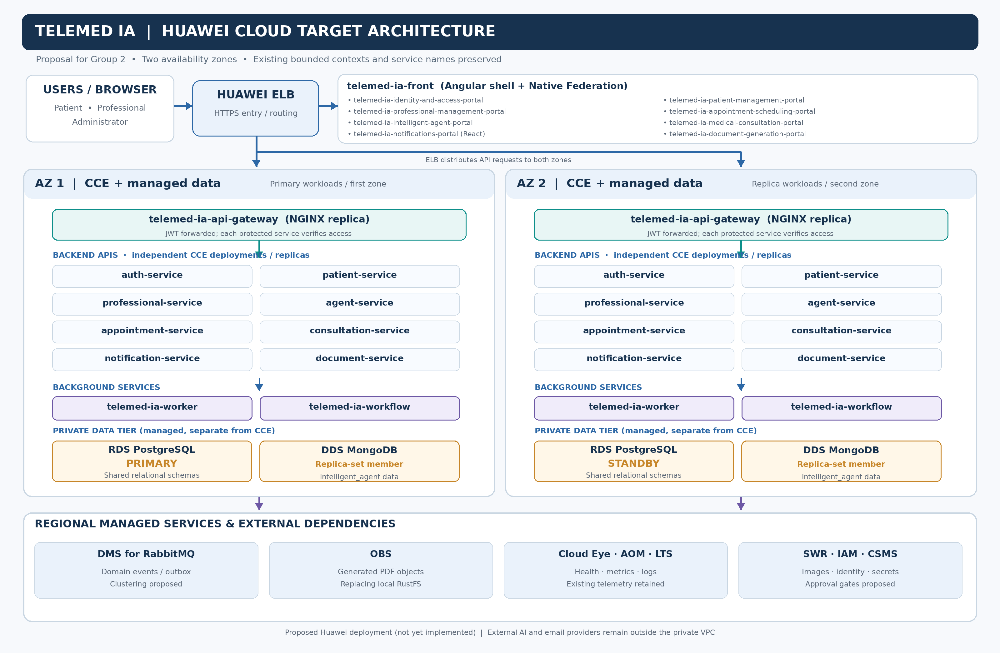

# Architecture design note — TeleMed IA (Group 2)

## 1. Target architecture

TeleMed IA is a telemedicine platform organized around eight bounded contexts. Patients can register, manage appointments, complete an intelligent pre-consultation, attend a medical consultation, and access authorized PDF summaries. Professionals review assigned appointments and clinical information; administrators manage users and professional onboarding. The current platform runs locally with Docker Compose. This note proposes a Huawei Cloud target architecture; it does not claim that our team has already deployed these cloud resources.

The original separation of responsibilities remains intact. An Angular shell loads seven Angular domain portals and one React notifications portal through Native Federation. Their shared HTTP client sends requests to the NGINX API Gateway, which forwards them to the appropriate business API. The gateway checks basic request conditions, applies rate limits, and propagates correlation identifiers, but **JWT signature, role, and resource ownership are validated by each protected service**. Internal service-to-service calls do not need to pass through the public gateway.

For the cloud deployment, I would place the containerized APIs, gateway, worker, and saga workflow on Huawei Cloud Container Engine (CCE), with application replicas distributed across **Availability Zone 1 and Availability Zone 2**. An Elastic Load Balance (ELB) endpoint would distribute incoming traffic to the gateway replicas. The frontend and its remote portals would be served as independently versioned web assets or containers. A private Virtual Private Cloud (VPC) would keep databases and the message broker inaccessible from the public internet.

| Component in the diagram | Defined in (file of your team's -docs) |
|---|---|
| `telemed-ia-front` and eight domain portals | `05-architecture/deployment.md` |
| `telemed-ia-api-gateway` / NGINX | `09-microservices/services/01-api-gateway/README.md` |
| `auth-service` (Identity & Access) | `09-microservices/services/02-auth-service/README.md` |
| `patient-service` | `09-microservices/services/03-patient-service/README.md` |
| `professional-service` | `09-microservices/services/04-professional-service/README.md` |
| `agent-service` | `09-microservices/services/05-agent-service/README.md` |
| `appointment-service` | `09-microservices/services/06-appointment-service/README.md` |
| `consultation-service` | `09-microservices/services/07-consultation-service/README.md` |
| `notification-service` | `09-microservices/services/08-notification-service/README.md` |
| `document-service` | `09-microservices/services/09-document-service/README.md` |
| `telemed-ia-worker` | `09-microservices/services/10-worker/README.md` |
| `telemed-ia-workflow` (saga orchestrator) | `09-microservices/services/11-workflow/README.md` |
| PostgreSQL: relational schemas and workflow state | `06-data/models.md` |
| MongoDB: `intelligent_agent` database | `05-architecture/decisions/records/ADR-020-infra-mongo-second-engine.md` |
| RabbitMQ event broker | `09-microservices/communication-patterns.md` |
| PDF object storage (currently RustFS) | `05-architecture/decisions/records/ADR-021-object-storage-rustfs.md` |
| Prometheus, Grafana, OpenTelemetry, Jaeger, Alertmanager | `05-architecture/deployment.md` |

The proposed relational layer uses **RDS for PostgreSQL**, with a primary database in AZ 1 and a standby in AZ 2. Domain ownership and dedicated credentials remain unchanged: each domain controls its own migration history, and cross-domain database writes remain prohibited. The existing shared-instance migration gap for Patient Management must be addressed before moving it. For the agent, the current `rs0` MongoDB replica set has only one node and therefore no automatic failover; a multi-node Huawei DDS deployment is a target option, subject to verifying MongoDB version, transaction, validation, and driver compatibility.

RabbitMQ transports asynchronous events, not clinical decision-making. The worker consumes events and coordinates document-generation requests using service credentials. The workflow service orchestrates professional-onboarding sagas, persists progress, and compensates completed steps after failures; it is **not** a running Camunda engine. Huawei DMS for RabbitMQ is a candidate replacement for the locally operated broker. PDF objects would move from RustFS to OBS after testing the S3 adapter and authorized download links. The external AI and email providers remain separate dependencies. For operations, existing Prometheus/OpenTelemetry instrumentation can be complemented by Cloud Eye, AOM, and LTS without recording patient messages or medical details in logs.

## 2. Five principles

| Principle | Current weakness | Evidence in -docs | Design decision | Huawei Cloud service |
|---|---|---|---|---|
| Reliability | Shared PostgreSQL runs on one local instance; MongoDB `rs0` has one member, leaving host-failure risks. | `05-architecture/deployment.md` | Use cross-AZ PostgreSQL primary/standby; evaluate a compatible multi-node MongoDB replica set and test failover. | RDS for PostgreSQL, DDS |
| Security | Secrets are managed in environment-specific files, without a centralized cloud secret lifecycle. | `10-devops/environments.md` | Keep per-service JWT validation and least-privilege database identities; centrally manage secrets and isolate private endpoints. | IAM, DEW/CSMS, VPC |
| Performance efficiency | Docker Compose does not automatically add API replicas as demand changes. | `04-requirements/non-functional.md` | Scale stateless agent and appointment APIs separately using CPU-based HPA; validate with load tests. | CCE, ELB |
| Cost | Fixed container capacity cannot automatically shrink under low traffic; an unplanned cloud lift would overprovision services. | `05-architecture/deployment.md` | Set service resource requests, limit autoscaling ranges, and review usage before resizing databases. | CCE, Cloud Eye |
| Operations | There is no hosted container registry or automated cloud release; GitHub Actions is also affected by the organization's billing limitation. | `10-devops/ci-cd.md` | Add image promotion, approvals, health checks, cloud metrics, logs, and a tested rollback pipeline. | SWR, CCE, AOM, LTS |

These are trade-offs rather than five generic cloud advantages. **Reliability** matters because several domains depend on the same PostgreSQL runtime. **Security** matters because healthcare and identity data must remain protected even if the gateway is bypassed by an internal request. **Performance efficiency** matters because AI requests and appointment operations have different traffic patterns. **Cost** matters because minimum replicas, managed databases, and multi-AZ redundancy consume resources even during quiet periods. **Operations** matters because a build that passes locally does not by itself prove that a cloud deployment is healthy.

The redesign preserves the team's ports-and-adapters approach: a cloud database, broker, or storage provider should be integrated through an infrastructure adapter rather than placed inside application business logic. This reduces the scope of changes when infrastructure is replaced. Any migration must still respect the API contracts, event schemas, idempotency keys, and data ownership described in the `-docs` repository. The proposed service choices need compatibility and cost checks in the selected Huawei region before implementation.

## 3. Scalability

| Service | Scaling metric | Threshold (number and unit) | Min instances | Max instances |
|---|---|---|---:|---:|
| `agent-service` | Average CPU utilization across CCE pods | 70% CPU utilization target | 2 | 6 |
| `appointment-service` | Average CPU utilization across CCE pods | 65% CPU utilization target | 2 | 4 |

These are **initial configuration targets, not observed production measurements**. CCE Horizontal Pod Autoscaling (HPA) would compare pod CPU usage with the targets and adjust replica counts within the configured bounds. At least two replicas would run across the two AZs when node capacity allows. Readiness probes, CPU requests, memory limits, and a PodDisruptionBudget should be configured before applying these policies. Cluster-node capacity must also be able to expand; HPA alone cannot create computing resources if the cluster has no available capacity.

`04-requirements/non-functional.md` expects at least 50 concurrent users, an intelligent-agent P95 below five seconds under 20 concurrent conversations, and appointment query/creation P95 below 700 milliseconds under its specified test load. I would use k6 tests to compare response times, error rates, and database-connection counts before and after scaling. CPU is only a starting signal: the agent may be waiting on an external AI provider even when CPU is low. Timeouts, the existing pre-consultation degradation controls, and outbox delivery must therefore remain independent of autoscaling. Appointment replicas must also preserve database-level concurrency protection so two patients cannot reserve the same slot.

## 4. Disaster recovery

- **Critical data store:** Shared PostgreSQL for authentication, appointment and consultation data, document metadata, and workflow saga state; proposed Huawei Cloud RDS for PostgreSQL.
- **RTO:** 5 minutes.
- **RPO:** 5 minutes.
- **DR pattern (chapter 11):** Hot standby / active-passive database architecture across AZ 1 and AZ 2, with backup and point-in-time recovery.
- **Why the pattern meets those numbers:** A pre-provisioned standby with tested automatic failover and application reconnection is designed to restore database-backed operations within the proposed five-minute RTO. Synchronous replication, where supported and configured, together with monitored replication health and recoverable backups, is designed to keep committed-data loss within the five-minute RPO.

The current `telemed-ia-infra-postgres/compose.yml` defines a single PostgreSQL container; the RDS arrangement would be a change, not a description of the running environment. Huawei RDS PostgreSQL supports cross-AZ primary/standby deployment, but replication is asynchronous by default, so the mode must be deliberately selected and tested. I would simulate a primary failure, record the time until the application becomes ready again, and check whether the final committed appointment and identity transactions survived. The test must also cover connection-pool recovery and services resuming their work without duplicating messages or saga actions. A backup alone cannot satisfy a five-minute RPO if it runs only once per day. Multi-AZ protection also does not equal cross-region disaster recovery; a regional outage remains outside this design's recovery guarantee.

## 5. Automated deployment

| Stage | Trigger | Tool or service | File in your team's repositories |
|---|---|---|---|
| Build | Pull request targeting `develop`, `qa`, or `main` | GitHub Actions and Maven | `telemed-ia-intelligent-agent-api/.github/workflows/ci.yml` |
| Test | Pull request / manual workflow dispatch | Maven tests and database migration checks | `telemed-ia-identity-and-access-api/.github/workflows/ci.yml`; `telemed-ia-identity-and-access-db/.github/workflows/db-ci.yml` |
| Image | Successful build and test (cloud push proposed) | Docker image build; Huawei SWR proposed | `telemed-ia-intelligent-agent-api/.github/workflows/ci.yml`; `telemed-ia-intelligent-agent-api/deploy/Dockerfile` |
| Deploy to qa | Approved promotion PR to `qa` (cloud automation proposed) | Current Docker Compose; future CCE | `telemed-ia-infra-postgres/scripts/up.sh`; `telemed-ia-infra-postgres/compose.yml` |
| Deploy to production | Approved release PR to `main` (cloud automation proposed) | Current Docker Compose; future CCE | `telemed-ia-infra-postgres/scripts/up.sh`; `telemed-ia-infra-postgres/compose.yml` |
| Rollback | Failed smoke tests or health checks (automation proposed) | Current manual stop/redeploy; future CCE rollout undo | `telemed-ia-infra-postgres/scripts/down.sh`; `telemed-ia-infra-postgres/compose.yml` |

The referenced paths are **real files in the team's repositories**, but the last three rows describe existing local deployment foundations, **not an already working automated Huawei pipeline**. `scripts/down.sh` preserves volumes by default; it does not roll back a released application image. A new deployment workflow and versioned Kubernetes manifests would be required to make QA deployment, production deployment, and rollback genuinely automatic. These must be added and verified before claiming that the automation requirement is fully implemented.

The intended sequence is to validate a pull request, build an immutable container image, scan it, publish it to SWR, and deploy that **same image digest** to QA on CCE. After smoke and contract tests, an authorized reviewer would approve promotion to production. Readiness checks and error-rate monitoring should gate the rollout; if verification fails, the deployment controller should restore the previously approved image while preserving persistent data. Database schema changes require backward-compatible migrations and independently tested rollback procedures; rolling back a container must not blindly undo committed healthcare data.

This sequence respects the project's existing `develop` → `qa` → `main` promotion policy with `cherry-pick -x` and pull-request approval. It also accounts for the documented current limitation: GitHub Actions workflows exist, but organization billing restrictions have blocked their execution, and the team currently records local test evidence. The cloud pipeline is therefore a future implementation proposal, not a claim about the present delivery.

## 6. Decisions

- [ADR-C3-01](ADR-C3-01.md): Propose multi-AZ RDS PostgreSQL primary/standby high availability, with a five-minute RTO and five-minute RPO subject to failover tests.
- [ADR-C3-02](ADR-C3-02.md): Propose CCE horizontal autoscaling for `agent-service` (70% CPU, 2–6 replicas) and `appointment-service` (65% CPU, 2–4 replicas).